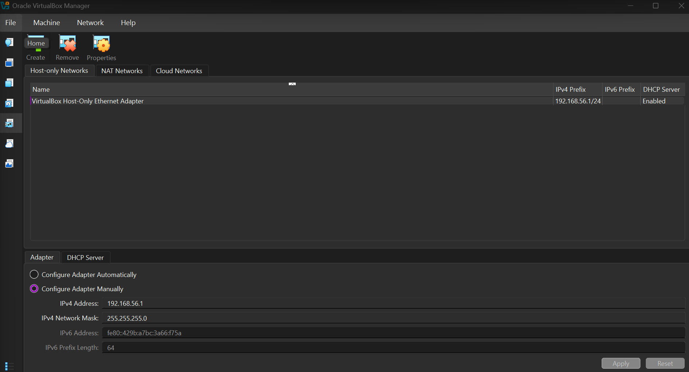
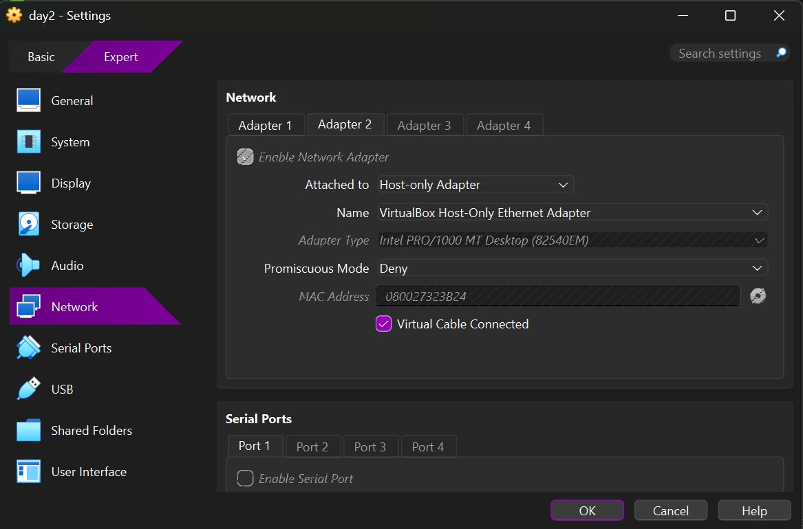
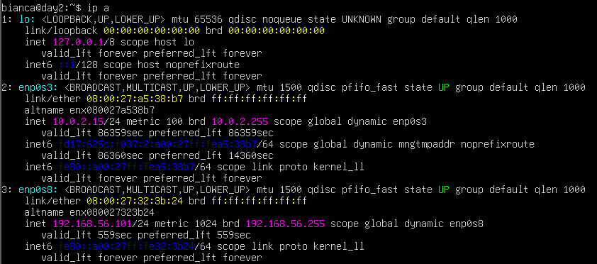
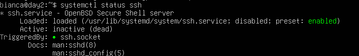

# Day NN: Ubuntu Server VM running

**Outcome:**  Ubuntu Server VM with internet access and a network reachable from Windows

**Done when:** 
* hostnamectl and ip a output pasted in the README
* the VM survives a reboot

## What I did

#### Create VM
1. Create VM using VirtualBox interface
    * Set VM name
    * Set username and password
2. Upgrade packages
    * `apt update` : refresh packeges already installed
    * `apt upgrade`: upgrade packages


#### Add NAT adapter to access internet

1. VM Settings -> Network -> Adapter 1 : already configured 
2. Test internet connection: `curl `

#### Host-only  adapter to access VM from Windows machine

1. VirtualBox interface (not VM) -> ctrl + H -> Host-only Network 
2. Create adapter
3. VirtualBox Host-Only Ethernet Adapter should be created. Enable it if necessary.

    Check properties. IP address here is NOT ip to VM, it's just a gateway. Check DHCP Server has "Enable Server" marked

 

 3. Power VM off to add Adapter 2 as Host-Only

 

 4. run `ip a` to check the new interface  shows up and get ip address

 

 5. Configure adapter (Ubuntu Server doesn't do it automatically)

    * Create a config file: `sudo nano /etc/netplan/60-hostonly.yaml`

        ```yaml
            network:
                version: 2
                ethernets:
                    enp0s8:
                        dhcp4: true
        ```
    * Fix permission: `sudo chmod 600 /etc/netplan/60-hostonly.yaml`

    * Apply changes : `sudo netplan apply`

#### SSH access

1. Check if SSH is running: `systemctl status ssh`
2. Install (if necessary): `sudo apt install openssh-server`
3. Check if SSH is running



4. Acsess from windows powershell `ssh <user>@ip`. Exemple: ` ssh bianca@192.168.56.102`

## What worked
1. Add adpter configuration, restaring VM and connection to it from windows with IP from `ip a`

## What did not work
1. Trying to config Adapters with VM on


## How I solved it
1. Power VM off -> change network configuration -> power VM on