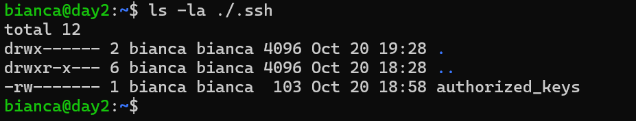
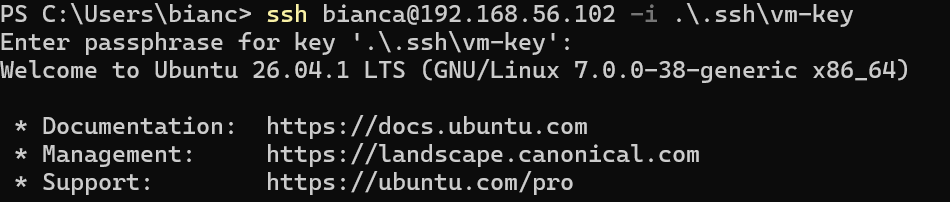
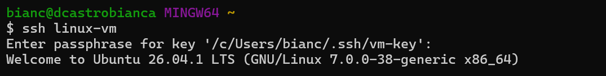

# Day 02: Connect with ssh with a key pair.

**Outcome:** Connect from the host to the VM over ssh with a key pair.

**Done when:** 
* ssh <vm> logs in without a password prompt
* list of the exact commands and where the key lives.

## What I did
1. Generate ssh key-pair in my Windows Machine
    
    PowerShell: `ssh-keygen -f ./.ssh/vm-key -t ed25519`

    Private key stays on my machine only: 
        
    

2. Send public-key file to VM to ~/.ssh/authorized_keys

    * Access VM from Windows
    * Create a file in VM:  `nano ./.ssh/vm-key.pub`
    * Copy pub key content to VM file
    * Copy content from vm-key.pub to authorized_keys file: `cat vm-key.pub >> authorized_keys`
3. Create a connection to VM from host using key configured
 `ssh bianca@192.168.56.102 -i .\.ssh\vm-key`

 

4. Create alias and access VM using [Config file](day-02/config)

## What worked
Copying the public-key after connecting to server from windows.

## What did not work
1. Trying to connect to VM without specifying private key file. It tried to use standart files `ssh bianca@192.168.56.102 -v` and as there was no valid key there, it requested the password.

## How I solved it
1. Add `-i file/path`to ssh command

## Link for doc
https://wiki.ubuntu.com/SSH/OpenSSH/Keys
