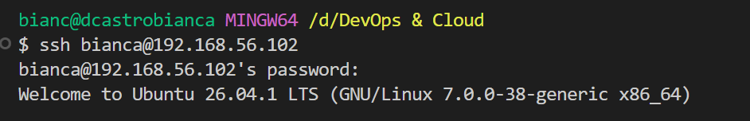
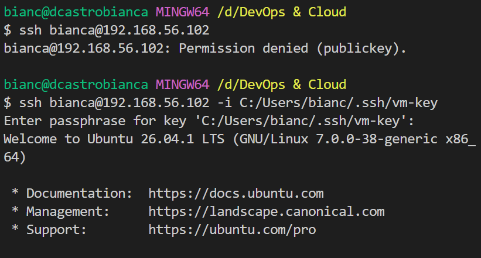
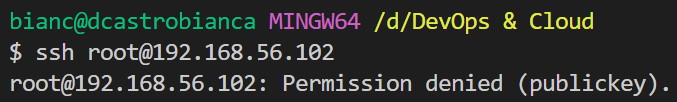
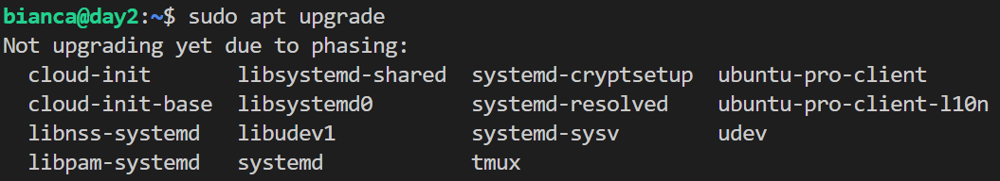

# Day 03: key-only ssh login

**Outcome:** The VM accepts ssh logins only with your key. Password login is switched off, you can explain why root cannot log in, and the installed packages are up to date.
**Done when:** 
1. ssh <user>@<vm-ip> with the key works. 
2. A login attempt that skips the key is rejected without being offered a password. 
3. ssh root@192.168.56.102 is rejected. 
4. apt list --upgradable shows nothing left. 
5. README states why root cannot log in (locked account or ssh setting) and lists the final ssh settings.

## What I did

### Restric password login in SSH
1. Verify I can use ssh conection with password

2. Acces /etc/ssh/sshd_config
3. Change configuration:
```
    PermitRootLogin no
    PasswordAuthentication no
    # ChallengeResponseAuthentication is a deprecated, replaced by:
    KbdInteractiveAuthentication no
    UsePAM no
```
4. Restart ssh service `sudo systemctl restart ssh`

5. Verify ssh connection to VM using password and key


5. Verify ssh connection to VM using root user



### Updagrade

1. Check packages that can be upgraded `apt list --upgradable`: there is 20 packages to update
2. Refresh list of available packages `sudo apt update`
3. Download and install newer versions `sudo apt upgrade`

I couldn't get an empty list when running `apt list --upgradable`, but that's only because Ubuntu's phasing release process. But as everything that could be updated at that moment was, I'm considering this task complete. 




## What worked
1. Staying connected to VM while changing SSH configurations, just in case I look myself out of it

## What did not work
1. Trying to change sshd_config without sudo, I got permission erros while trying to save


## How I solved it
1. I just run `sudo nano ....`

## What I would do differently
1. Add changes to `/etc/ssh/sshd_config.d/*.conf` as they override the changes from `/etc/ssh/sshd_config`
2. Run upgrade command together in future `sudo apt update && sudo apt upgrade`

## Links
[Config options](https://manpages.ubuntu.com/manpages/resolute/man5/sshd_config.5.html)