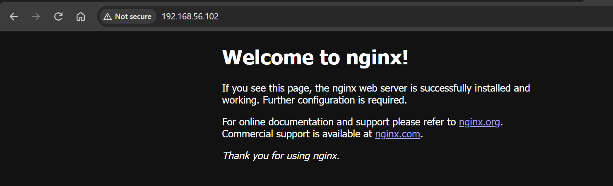
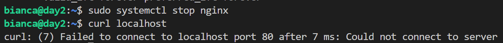
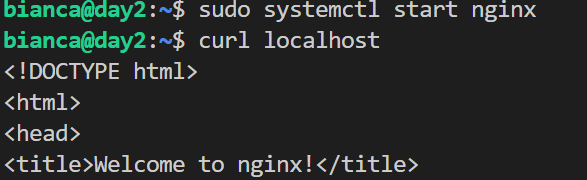
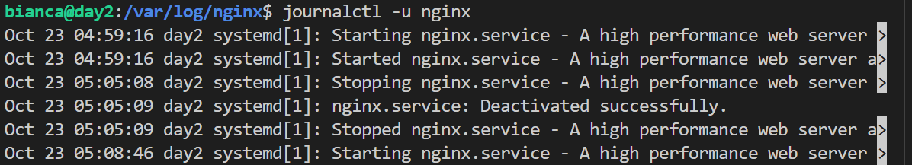

# Day 04: Nginx managed with systemd

**Outcome:** Install nginx with apt and manage it with systemctl.

**Done when:** 
1. curl http://<vm-ip> from the host returns the nginx default page; 
2. after systemctl stop nginx the curl fails;
3. after start it works; 
4. journalctl -u nginx shows both events.

## What I did
 1. `sudo apt update`
 2. `sudo apt install nginx`
 3. Test web server running: `curl localhost` from VM
 4. Confirm the default page loads from Windows:
    
    * Test acces `curl <ip>`
    * Acces in browser

    

5. Stop Nginx `sudo systemctl start nginx`

4. Start Nginx `sudo service nginx start`

5. Check service manager logs for start and stop request: `journalctl -u nginx`

## What did not work
1. Fisrt I checked Nginx logs trying to find start and stop of the process, but Nginx controlss only it's own logs access.log and error.log which are written by nginx itself. Start and Stop of services it's handled by systemd, the service manager.

## How I solved it
1. Access systemd central store, with journalctl command.
