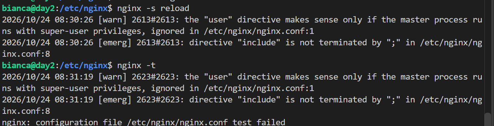
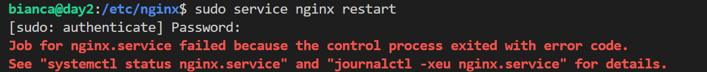
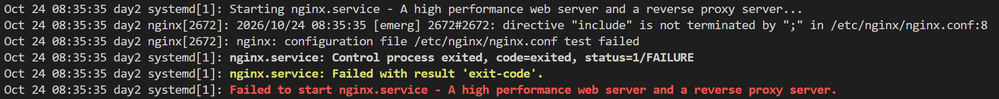

# Day 05: Break and fix

**Outcome:** Break the nginx config on purpose, find the error from the tools, fix it.

**Done when:** 
1. Error located with `nginx -t` and `journalctl`, fixed, and written down; 

## What I did

1. Access nginx config `/etc/nginx/nginx.conf`
2. Introduce error: remove a semicolon from the end of one line
3. Reload config `nginx -s reload`
4. Check error `nginx -t`

    
    

    Config invalid and not applied, web server still accessible. 

4. Restart service 
    `sudo service nginx restart`. 
    
    Config was applied and service couldn't start, web server unaccessible. 

    

5. Check service error  `journalctl -u nginx`

    

6. Fix error and restart service. Web server is again accessible.

## What worked
1. Easiest error possible: remove a semicolon. 

## What did not work
1. I tried first pointing root at a missing folder, which does not fail the config test, because that is only a path nginx checks when a request arrives. 

## How I solved it
1. To make a config fail, I'd need to point a include line to an unexisting file.

## What I learned
1. There are two types of nginx error:
    * Config erros, which make the service stop working when applied.
    * Runtime errors: config is valid, nginx runs but something goes wrong and gets logged in error.log. 
