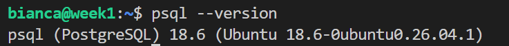
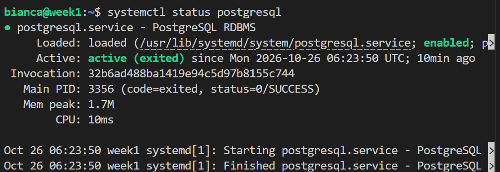
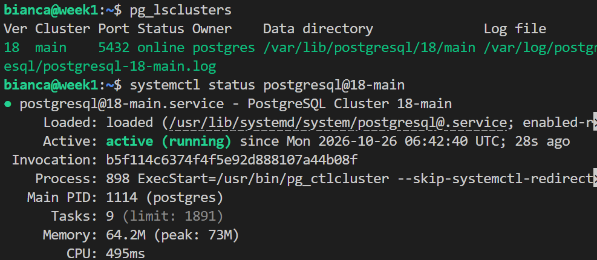
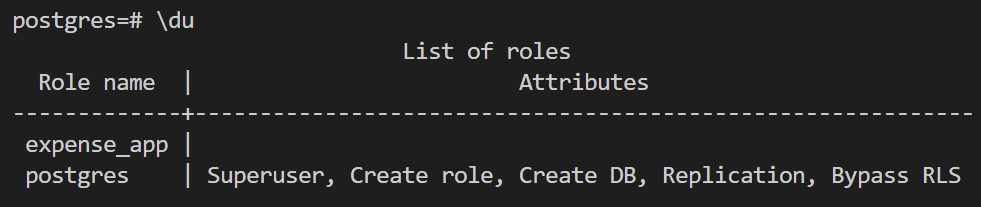
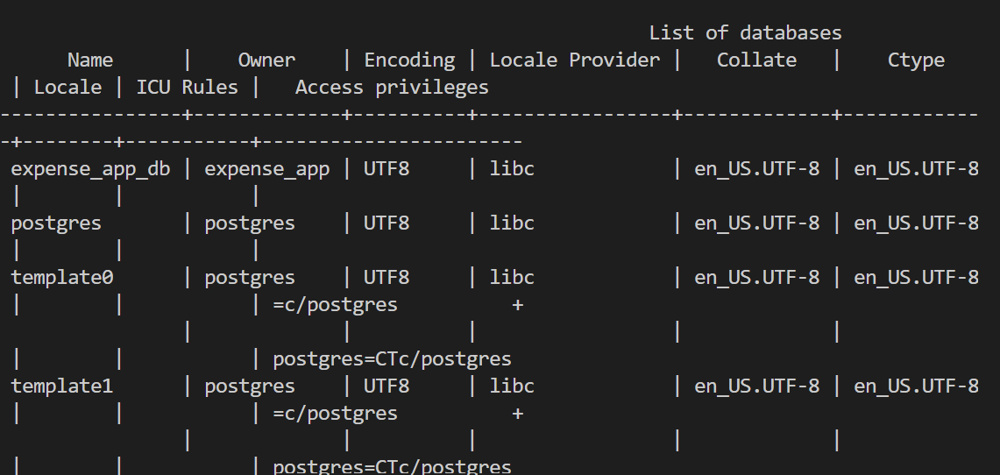
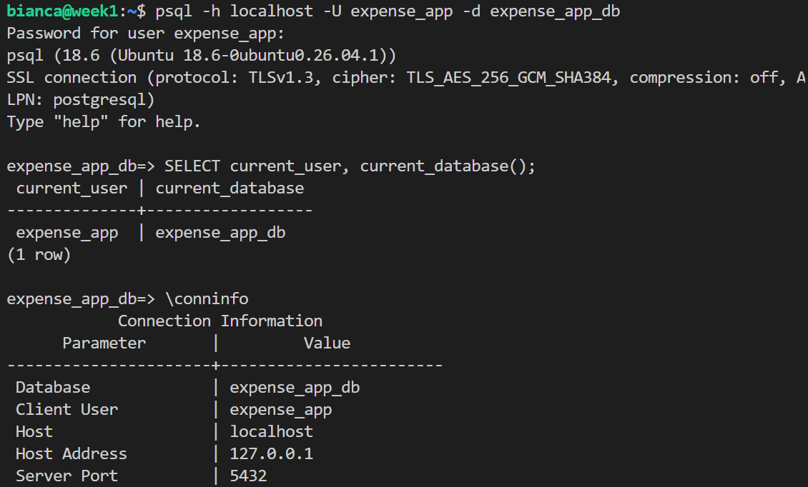
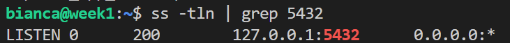
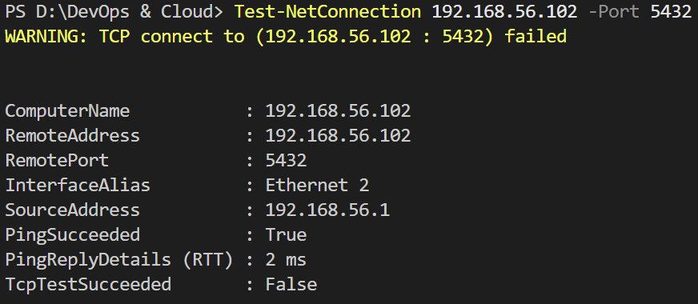

# Day 06: PostgreSQL on the VM

**Outcome:** PostgreSQL runs on the VM with its own database and user for the app, and accepts connections only from the VM itself.

**Done when:** 
1. PostgreSQL is active and starts again after a VM reboot. 
2. The app's database user can log in from the VM and use its own database. 
3. A connection attempt from Windows to the database port is refused. 
4. README records the database name, the user, and where the password is kept (not the password itself).

## What I did
1. Install postgreSQL

    * `sudo apt update && sudo apt install postgresql` - update list of packages and install PostgreSQL

    * `psql --version` - check version

    

    * Service should be marked as `enabled` to restart after reboot

        `systemctl status postgresql`


        


2. Check server before and after reboot

    * `pg_lsclusters` - list clusters on VM

    * `systemctl status postgresql@18-main` - show info on service of cluster version 18

    * `sudo reboot`

    * Check cluster is still active running `pg_lsclusters`

    

3. Create the app’s database and a dedicated user.

    database: expense_app_db

    user: expense_app

    password: saved in my password manager for now.

    * Start admin console using OS identity for connection. Uses `postgres`superuser. No password is needed because of `local` line in `pg_hba.config`
        
        `sudo -u postgres psql`

        ```sql
            CREATE ROLE expense_app LOGIN NOSUPERUSER NOCREATEDB NOCREATEROLE;
            \password expense_app
            CREATE DATABASE expense_app_db OWNER expense_app;
        ```

        Inside of admin console:
        `\du` to check list of roles and `\l` to check list of  databases. `\q` to exit.


        

        

4. Connect to DB as the app user
    * `psql -h localhost -U expense_app -d expense_app_db` and type expense_app password

    * Inside psql 

    ``` sql
    SELECT current_user, current_database();
    \conninfo
    ```

    

5. Database is not reachable from Windows
    * On VM list network sockets with `ss -tln | grep 5432`

    The Local Address column shows the interface the server is bound to:`127.0.0.1:5432`, that means only the VM itself can connect to it, which is `listen_addresses = localhost` from PostgreSQL config in action.

    

    * On Windows Powershell `Test-NetConnection <vm-ip> -Port 5432`

    
    

## What worked

1. `\du` shows an empty list of attributes for user `expense_app`, which means it has no privileges. It's different when compared to `postgres` user, which is a superuser and has all the privileges. 

## What did not work
1. Check information about postgres with `systemctl status postgresql`. On Ubuntu, `postgresql.service` is an umbrella unit that exists so you can start or stop all clusters at once. I saw `active (exited)` and understood that the database was running, but it doesn't control the databases, but all postgre clusters.

## How I solved it
1. The real postgres service runs in a separate unit per cluster, named after the version and the cluster name. To check the version I installed was running I needed to use `systemctl status postgresql@18-main` .