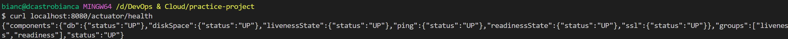
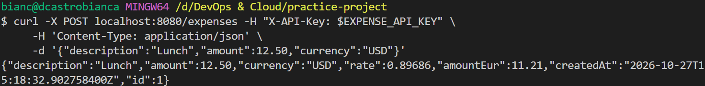
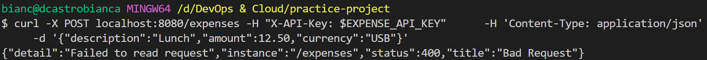
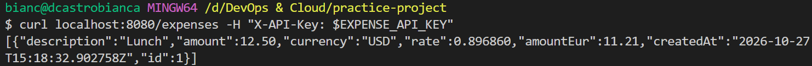
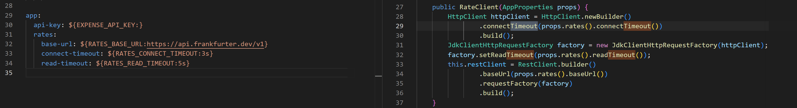
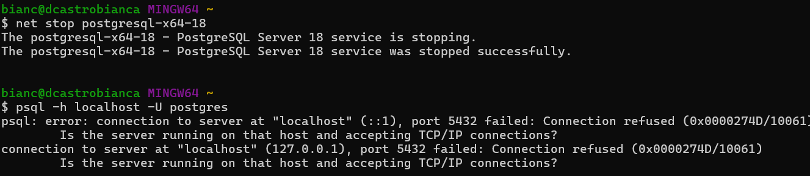
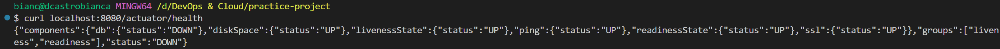
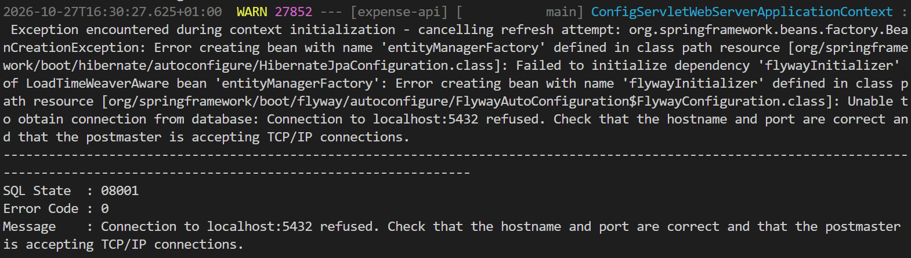

# Day 07: Generate and review the app with Claude code

**Outcome:** The expense app is generated, reviewed against five points, and committed to the repo.
**Done when:** 
1) The code is in it's own repository: https://github.com/dcastrobianca/basic-expense-app

2) Your review notes cover the five review points. 
3) You can explain in one paragraph how the app starts and what it needs to run.

## What I did

1. Generated the code using Claude Code integrated with my VS Code Ui.
2. Create api-key
    * Create key: `setx EXPENSE_API_KEY "$(openssl rand -hex 32)"`
    * restart terminal and VS Code
    * Check if key was stored properly: `[ -n "$EXPENSE_API_KEY" ] && echo "set" || echo "missing"`

3. Create database in windows-machine
    * Install postgres in Windows. Windows Setup Wizard makes define superuser mandatory for instalation.
    * Enable psql CLI by adding bin folder to Path. Test with `psql --version`
    * Connect to DB server with superuser and used comands from day-06 to create dedicated user and database. 
        * `psql -U postgres -h localhost`
        * Create user and its password
        ```sql
            CREATE ROLE expense_app LOGIN NOSUPERUSER NOCREATEDB NOCREATEROLE;
            \password expense_app
        ```
        * Create database.
        ```sql
            CREATE DATABASE expense_app_db OWNER expense_app;
        ```

        As application will user FLyway, should not create tables manually, as it would generate conflic with the tool and would make the application not start. 

    * Add db password to system environment variables 

4. Start Application up
    * Send basic requests
        * GET \health
            

        * POST \expense with valid parameters
            

        * POST \expense with invalid currency
            
        * GET \expense
            


5. 5 Review points
    1. No default passwords or keys anywhere.
        I only added system environment variables to configure api-key and db password. They are also not logged anywhere by the application.

    2. The timeouts really exist.

        

    3. What happens at startup when the database is unreachable.

        * Stop Postgres cluster 18 `net stop postgresql-x64-18` with app up and running

            

        * Send heath request

            

            DB is showing as down, as app cannot establish connection to server.

        * Restart app with db server still unavailable, app doen't start.

            

            Spring Boot applications that have Spring Data JPA will automatically look to create a database connection. 
            If it cannot establish this connection, the application will fail, unless it's configured otherwise.


    4. The README matches the config variables in the code.
    5. You can state the port, the config location and the secrets in one paragraph.


## What worked
1. Preperaing apps dependency before hand, like api key and postgrest service instalation, while AI generated the code. This way, I optimized my time. I just had to change the configuration from my application after to match what I had configured.

## What did not work
1. I tried creating the tables for postgres db manually, and that made the application fail when starting. 

## How I solved it
1. I connected to database, dropped the table and restarted the application. 

## What I would do differently
1. Use a docker container to run the database would make it easier for future sessions, like "on repeat". 