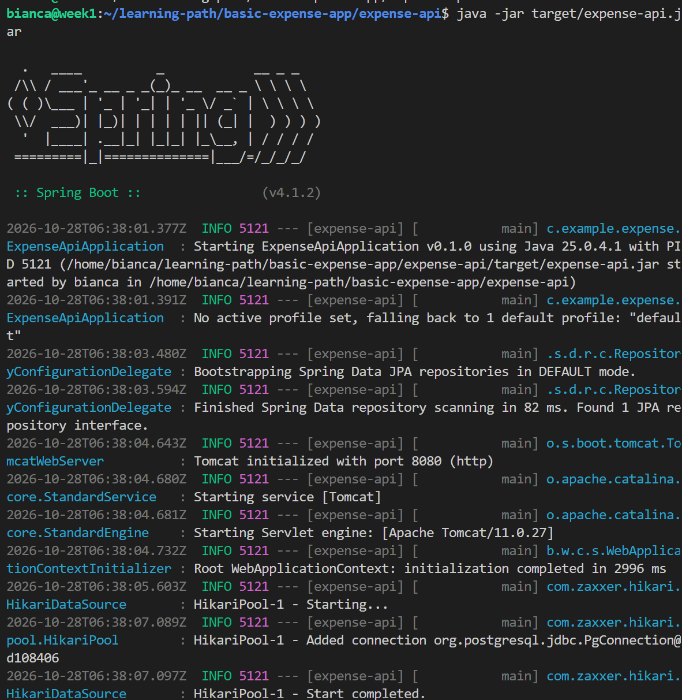
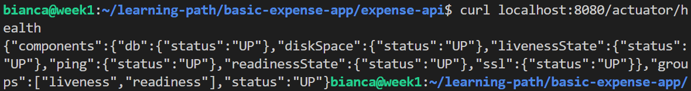
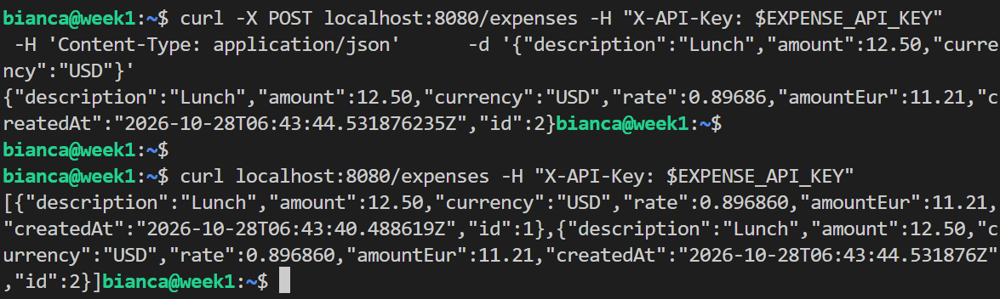
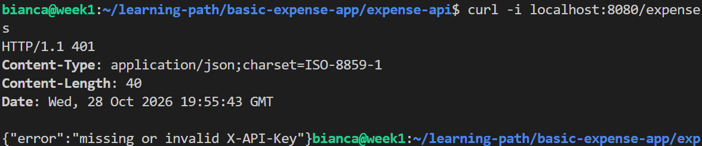
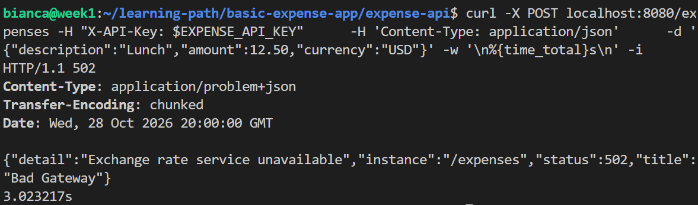
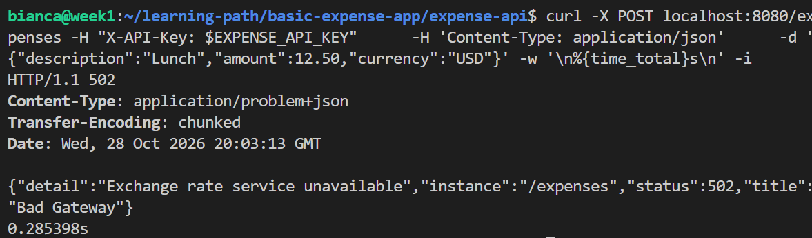
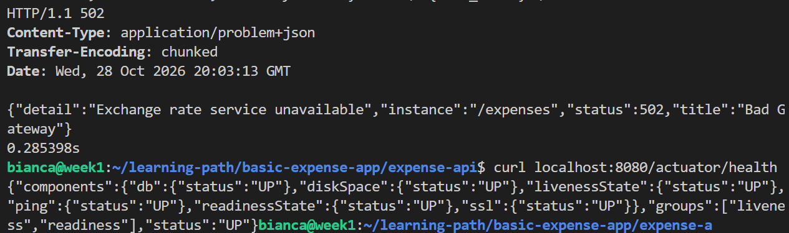

# Day 08: The app builds into one jar and runs by hand against PostgreSQL

**Outcome:** The app builds into one jar on the VM and runs by hand against PostgreSQL, with the API key and the external rate call working.

**Done when:** 
1) GET /actuator/health reports the database as up. 
2) POST /expenses with the key stores a row with the EUR amount; GET /expenses returns it. 
3) A request without the key returns 401. 
4) With the external service address set to an unreachable one, POST /expenses returns 502 and the app keeps running. 
5) README lists the build and run commands you used.

## What I did
1. Install 
    * Java

        `sudo apt install openjdk-25-jdk-headless`

        As the application will be build on the VM, the JDK is required. If the VM was responsible just to run the application, installing just JRE would be enough and would save disk space.

        `sudo apt install openjdk-25-jre-headless`

        Check installation: `java -version`

    * Install maven

        `sudo apt install maven`
        `mvn -version`

    * Install git

        `sudo apt install git`

2. Build the jar

    * Access POM folder 
        
        `cd learning-path/basic-expense-app/expense-api`

    * Build jar
        
        `mvn package`

3. Run by hand
    * Create secrets in environment variables with:
        
        `export DB_PASSWORD_EXPENSE='...'`

        `export EXPENSE_API_KEY='...'`

    * Run 
        
        `java -jar target/expense-api.jar`

        

4. Testing requests
    * GET /actuator/health

        `curl localhost:8080/actuator/health`

        
    
    * POST /expenses and GET /expenses

        `curl -X POST localhost:8080/expenses -H "X-API-Key: $EXPENSE_API_KEY" -H 'Content-Type: application/json' -d '{"description":"Lunch","amount":12.50,"currency":"USD"}'`

        `curl localhost:8080/expenses -H "X-API-Key: $EXPENSE_API_KEY"`

        

    * Request without valid key

        `curl -i localhost:8080/expenses`

        

5. Define invalid service address. 
   * Service address that never answers.
        * Add environment variable `export RATES_BASE_URL='http://10.255.255.1`
        * Restart app
        * Send request with response time and status line 
            
            `curl -X POST localhost:8080/expenses -H "X-API-Key: $EXPENSE_API_KEY"      -H 'Content-Type: application/json'      -d '{"description":"Lunch","amount":12.50,"currency":"USD"}' -w '\n%{time_total}s\n' -i`
        
            

            Answer only comes after timeout of 3 seconds is reached.


   * Service address refuses immediatly 
        * Add environment variable `export RATES_BASE_URL='http://localhost:9`
        * Restart app
        * Send request with response time and status line 
            
            `curl -X POST localhost:8080/expenses -H "X-API-Key: $EXPENSE_API_KEY"      -H 'Content-Type: application/json'      -d '{"description":"Lunch","amount":12.50,"currency":"USD"}' -w '\n%{time_total}s\n' -i`
        
            

            Answers comes right way with 502 error.
    * Service is still running after error 502
        

## What worked
1. Restart the application after changing environment variables to reload configurations. I tested runing the application in the backgroug and changing the `RATES_BASE_URL` and sending a request, the return showed me that the configuration is not reloaded when a environment variable  changes.

## What did not work
1. Build from a path that didn't contain POM file.

2. Defining secrets using `export` command don't persist in diferent sessions or after reboot. Solution documented in first item of What I would do differently.

## How I solved it
1. Access the path in which POM file is locatted before run build command. 

## What I would do differently
1. Define secrets in a more permanent way
    * Create file with permission set (readable and writable only by owner). `/etc/<app>/` follows convention for service configuration.

        `sudo mkdir -p /etc/expense-api`

        `sudo install -m 600 -o bianca -g bianca /dev/null /etc/expense-api/expense-api.env`

    * Add secrets to file. Format already prepared to be used by systemd

        `nano /etc/expense-api/expense-api.env`

        ```
            DB_PASSWORD_EXPENSE=my-db-password
            EXPENSE_API_KEY=my-api-key
        ```
    * Load secrets automatically in every session.
        * `nano ~/.bashrc`
        * Add to end of the file
        ```
            set -a
            source /etc/expense-api/expense-api.env
            set +a
        ```

    * Open new session and test 

        `[ -n "$EXPENSE_API_KEY" ] && echo set || echo missing`
        

