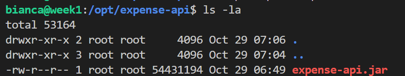
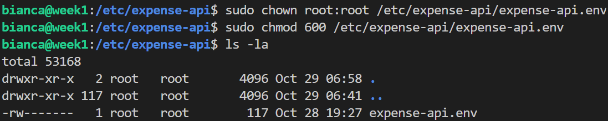
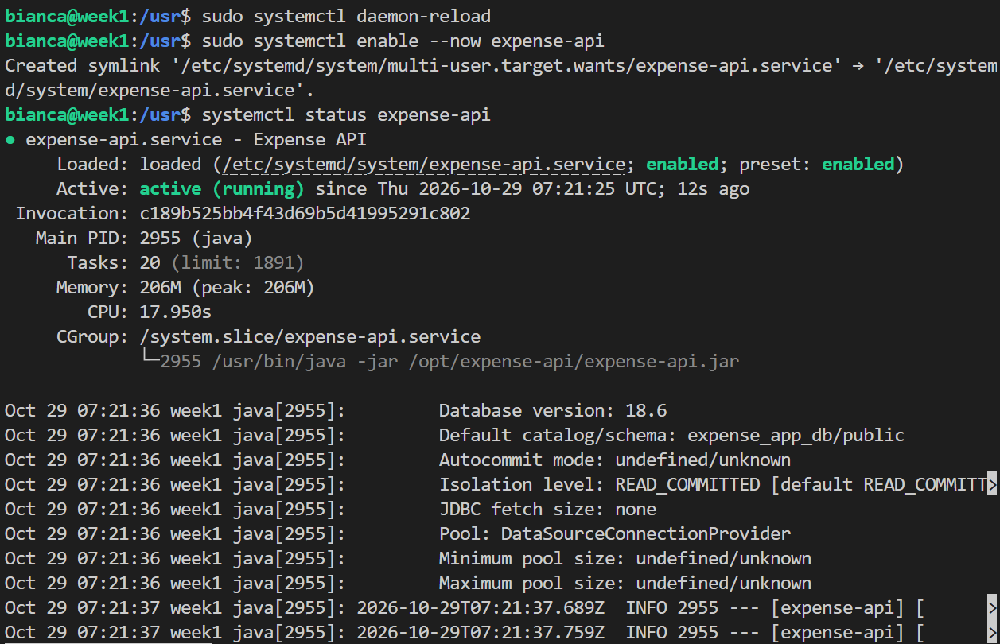
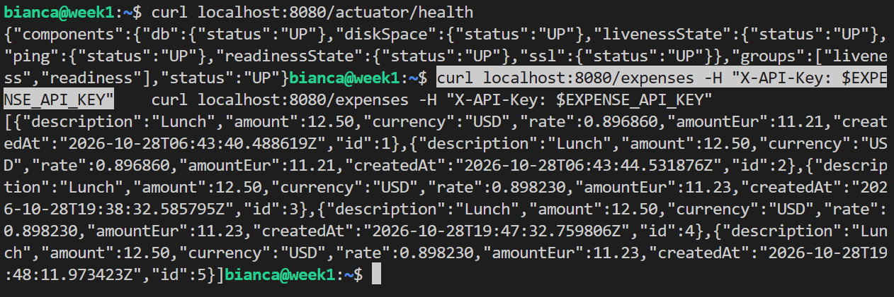
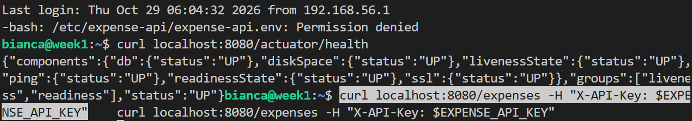
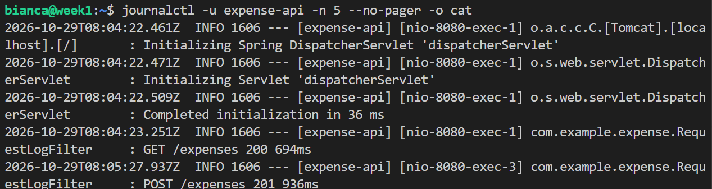
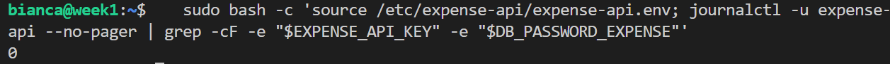
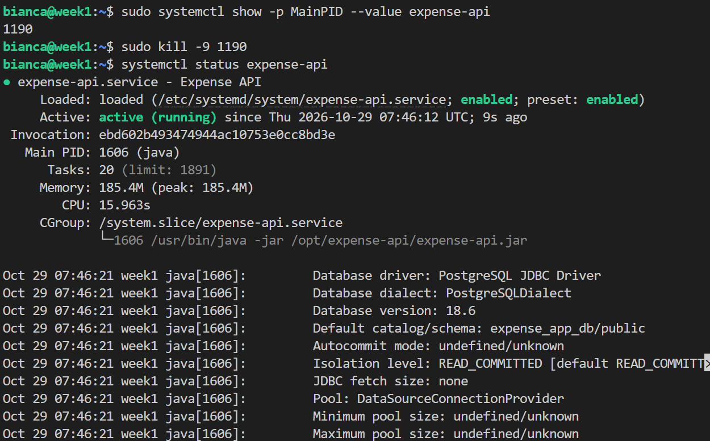
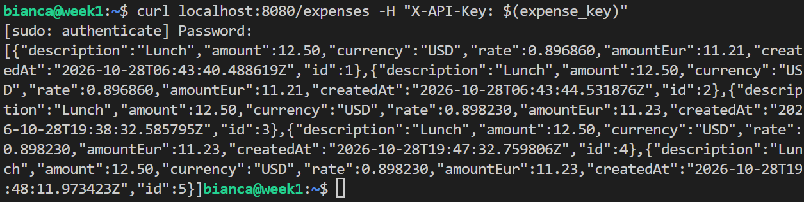

# Day 09: The app runs as a systemd service under its own user

**Outcome:** The app runs as a systemd service under its own user, with its secrets in a protected file, and comes back after a crash and after a reboot.

**Done when:** 
1) The service is active after a VM reboot with no manual start. 
2) After the app process is killed, the service starts it again. 
3) The secrets file is readable only by the service user, and no secret appears in the repo or in the service logs. 
4) journalctl for the service shows the app's request log lines. 
5) README lists the service definition and where the secrets file lives.

## What I did
1. Create dedicated app user
    `sudo useradd --system --no-create-home --shell /usr/sbin/nologin expense-api`

    `--system` creates an account meant for a service: a low user ID, and none of the normal-user defaults such as password aging.
    `--no-create-home` skips the home directory, since the service doesn’t need one.
    `--shell /usr/sbin/nologin` means nobody can log in as this user. It exists only so systemd can run the process under it.

2. Create create application's own file path and move jar

    It should be separate from secrets to make possible have permissions set by directory. Follows convetion path. 

    `sudo mkdir -p /opt/expense-api`

    `sudo mv /home/bianca/learning-path/basic-expense-app/expense-api/target/expense-api.jar /opt/expense-api/`

4. Change jar file permission: Root-owned and world-readable

    `sudo chown root:root /opt/expense-api/expense-api.jar`
    `sudo chmod 644 /opt/expense-api/expense-api.jar`

    

5. Change file secret permission: owned, readable and writable by root only 

    `sudo chown root:root /etc/expense-api/expense-api.env`
    `sudo chmod 600 /etc/expense-api/expense-api.env`

    

6. Service definition

    `sudo nano /etc/systemd/system/expense-api.service`

    ```
        [Unit]
        Description=Expense API
        After=network.target postgresql.service

        [Service]
        User=expense-api
        EnvironmentFile=/etc/expense-api/expense-api.env
        ExecStart=/usr/bin/java -jar /opt/expense-api/expense-api.jar
        SuccessExitStatus=143
        Restart=on-failure
        RestartSec=5

        [Install]
        WantedBy=multi-user.target
    ```

    `After=` makes sure the app just start after network and PostgreSQL, to avoid a missing database error. `SuccessExitStatus=143` makes a SIGTERM stop count as a clean exit, as in the Spring page you read. `RestartSec=5` waits 5 seconds before restarting, so a crashing app can’t spin in a tight loop. `WantedBy=multi-user.target` is what enable hooks into, so the service starts at boot

7. Load and start expense-api.service
    * Systemd re-read unit files
        `sudo systemctl daemon-reload`
    * Register service for boot and start right away
        `sudo systemctl enable --now expense-api`
    * Check status, should be enabled and active
        `systemctl status expense-api`
    
    

8. Send requests to expense-api
    * Before reboot

        

    * After reboot

        

    * Check service logs

        `journalctl -u expense-api -n 5 --no-pager -o cat`

        

    * Check if secrets are written in service logs

        `   sudo bash -c 'source /etc/expense-api/expense-api.env; journalctl -u expense-api --no-pager | grep -cF -e "$EXPENSE_API_KEY" -e "$DB_PASSWORD_EXPENSE"'`

        
    
9. Crash test
    `sudo systemctl show -p MainPID --value expense-api`

    `sudo kill -9 <pid>` end service abruptly, counts as a crash and with `Restart=on-failure` systemd should start it again after `RestartSec=5`.

    `systemctl status expense-api`

    

## What did not work
1. Sending a request with api-key after reboot. ~/.bashrc cannot access secret files anymore

## How I solved it
1. Remove configuration from ~/.bashrc to read secret file.
    `nano ~/.bashrc`
2. Add configuration to get the api-key for curl requests

    ```
    expense_key() { sudo grep '^EXPENSE_API_KEY=' /etc/expense-api/expense-api.env | cut -d= -f2-; }
    ```

    
3. Reload config and use new script in curl 
    `curl localhost:8080/expenses -H "X-API-Key: $(expense_key)"`

    
