# Day 10: <topic>

**Outcome:** Three deliberate failures are found from the logs and fixed, and the week is documented so it can be repeated.

**Done when:** 
1) Each of the three failures (PostgreSQL stopped, app port already in use, jar file with wrong permissions) is found with journalctl or the service status and fixed. 
2) Week demo: after a VM reboot the app is back by itself and its data is still in the database. 
3) The week README "On repeat" includes every command from the week.

## What I did

1. Ajust timezone
    `timedatectl status`

    `sudo timedatectl set-timezone Europe/Berlin`

    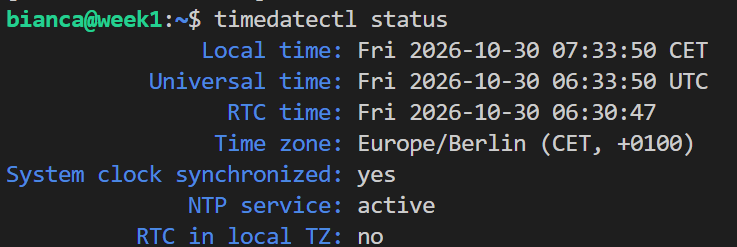

2. PostgreSQL stoped

    * Deactivate PostgreSQL 

        `sudo systemctl stop postgresql@18-main`
        
        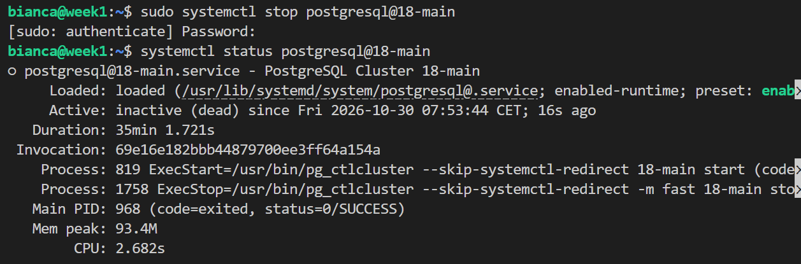


    * Health check request

        `curl -i localhost:8080/actuator/health`

        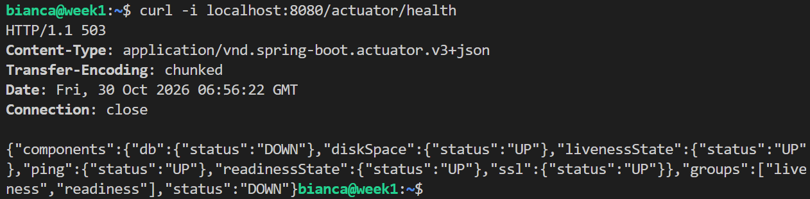

    * POST /expenses request

        `curl -i -X POST localhost:8080/expenses -H "X-API-Key: $(expense_key)" -H 'Content-Type: application/json' -d '{"description":"Test","amount":5,"currency":"USD"}' -w '\n%{time_total}s\n'`

        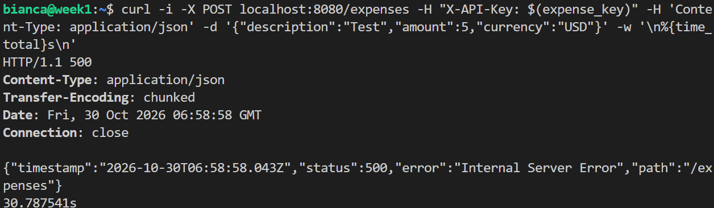


    * Check expense-api service health

        `systemctl status expense-api`

        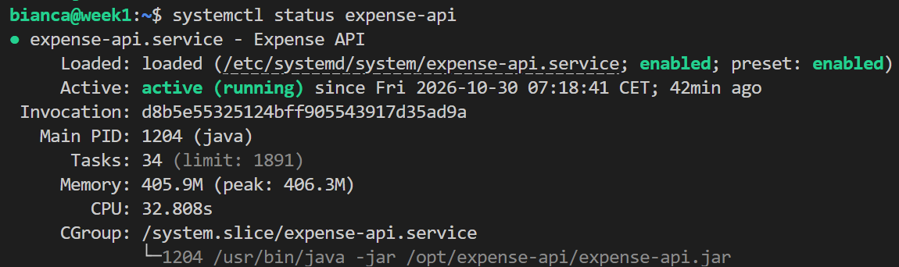

        `journalctl -u expense-api -n 30 --no-pager`

        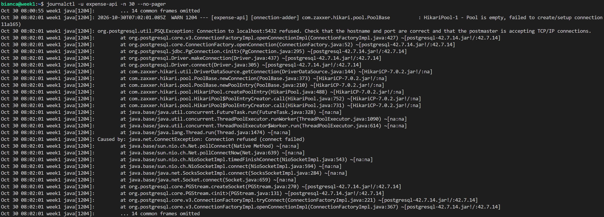

    The service continues to run normally, but when trying to connect to database it gets and error showed by the log `org.postgresql.util.PSQLException: Connection to localhost:5432 refused. Check that the hostname and port are correct and that the postmaster is accepting TCP/IP connections.`. The process is never restarted, because it doesn't exit with failure.

    * Restart PostgreSQL

        `sudo systemctl start postgresql@18-main`

        `systemctl status  postgresql@18-main`

        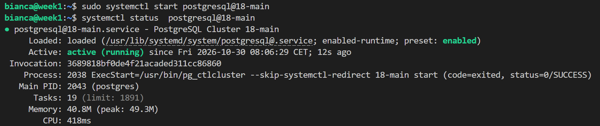

    * Send GET health and POST /expenses requests again

        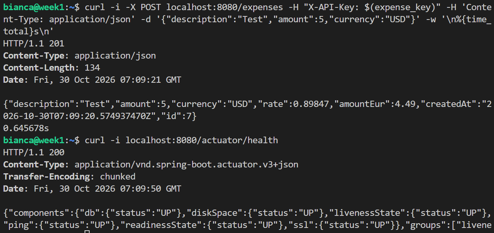

    
    As the process continued to run, even without database connection, after restart the PostgreSQL service, there is no need to restart the app. The conection it tried again, and this times it succeeded as shown by the request. 


2. Port already in use
    * Stop service
        `sudo systemctl stop expense-api`

    * Make port busy. Use a different session.

        `nc -l 127.0.0.1 8080`

        

    * Start service and check it's health

        `systemctl status expense-api`

        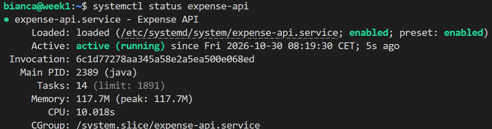

        `journalctl -u expense-api -n 25 --no-pager -o cat`

        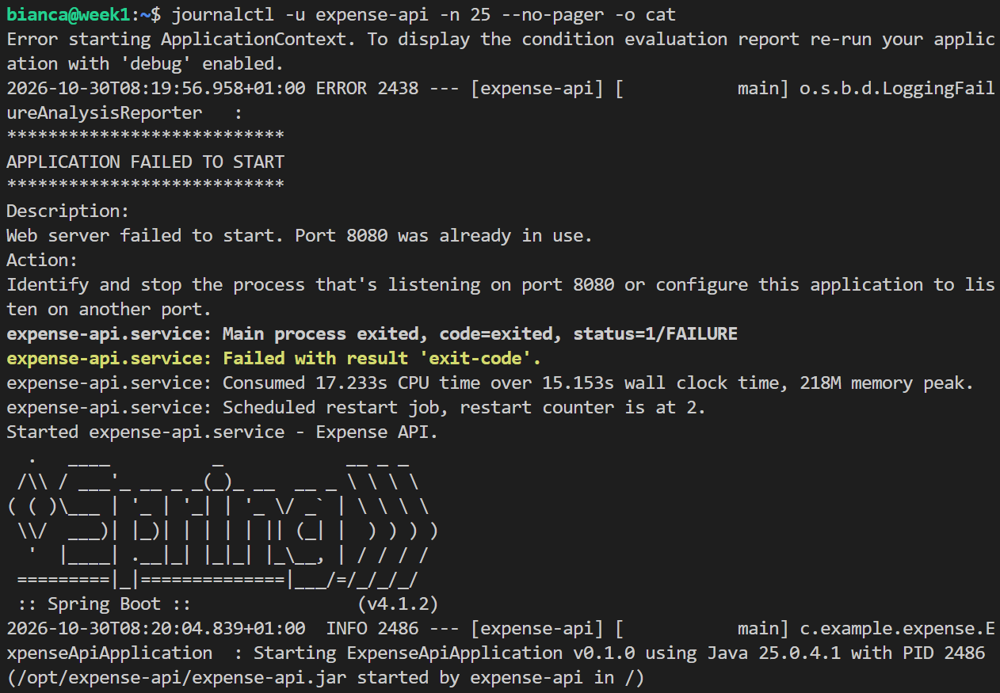

        The status shows app is running, but app cannot start, as shows in `Web server failed to start. Port 8080 was already in use.`. With the port being used, it keeps crashing and restarting after 5 seconds. Last error log: 08:19:56. Start application log 08:20:04. 

        After the port is free, the application finally can start

        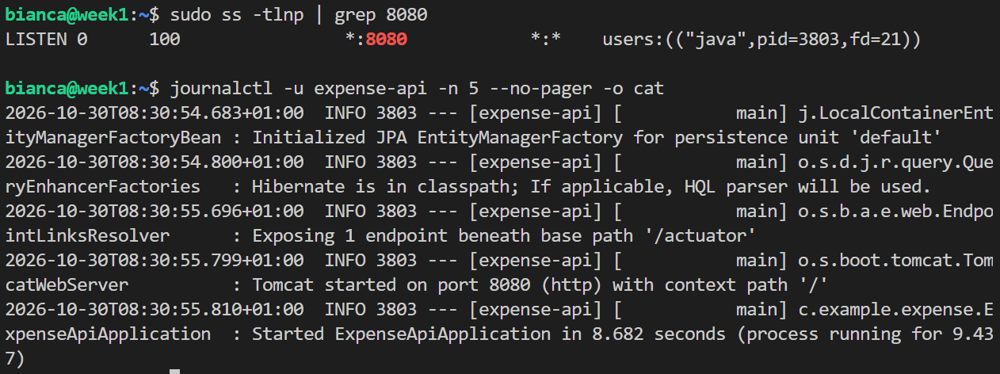

3. Jar file with the wrong permission
    * Change permission for jar file , so only root can access it. 
        `sudo chmod 600 /opt/expense-api/expense-api.jar`

        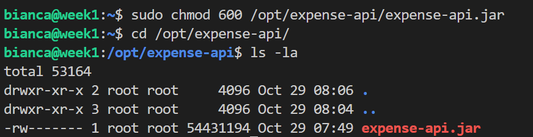
    

    * Restart expense-api service

        `sudo systemctl restart expense-api`

    * Check service health and logs

        `systemctl status expense-api`

        `journalctl -u expense-api -n 15 --no-pager`

        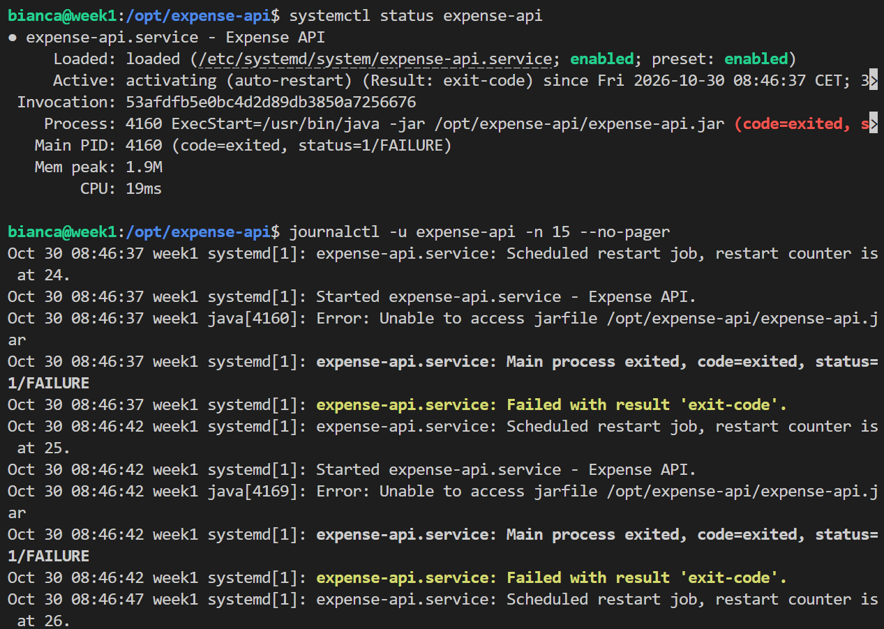

    * Check user access to jar file

        `sudo -u expense-api test -r /opt/expense-api/expense-api.jar && echo readable || echo not readable`

        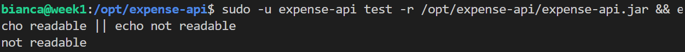

    With app dedicated user without access to jar file, the status keeps at `activating (auto-restart)` and the logs shows `Error: Unable to access jarfile /opt/expense-api/expense-api.jar`. 

    * Fix Jar permission and check service's health

        `sudo chmod 644 /opt/expense-api/expense-api.jar`

        `systemctl status expense-api`

        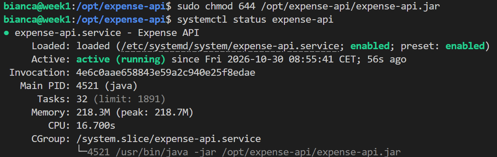

4. Reboot and week demo
    * Reboot 
        `sudo reboot`
    * Check services status

        `systemctl is-active expense-api postgresql@18-main`

        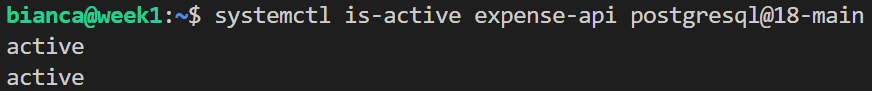

    * Check data persistance

        `curl localhost:8080/expenses -H "X-API-Key: $(expense_key)"`

        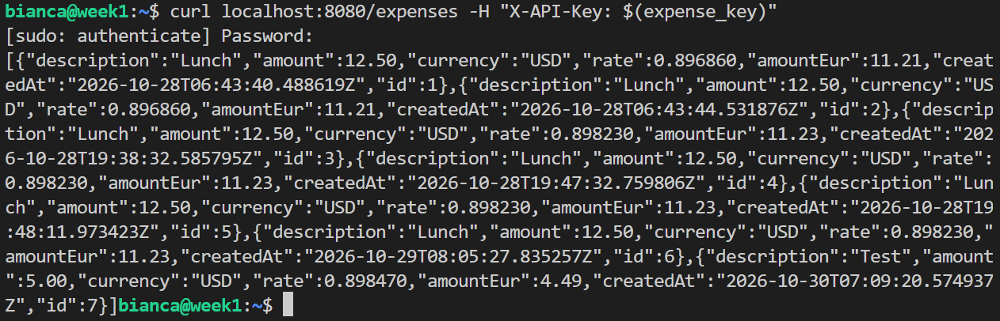

## What worked
Finding the error using journalctl worked for all the erros I introduced. I could find the error directly writen in the logs. 

## What did not work
1. Change secret file permission to 000.

    ```
        sudo chmod 000 /etc/expense-api/expense-api.env
        sudo systemctl restart expense-api
        systemctl status expense-api
    ```

    Root is not stopped by file permission bits. Mode 000 blocks ordinary users, but root bypasses those checks.So even with permission set to 000, systemd still manages to read the secret file using root and app starts normally. 

    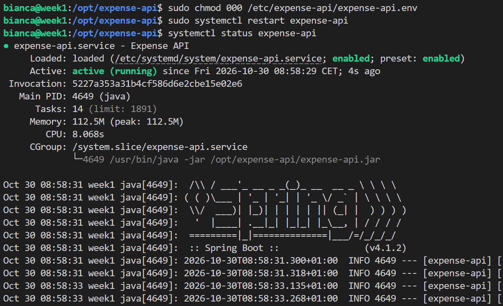

## How I solved it
1. Returned secret file permission to proper configuration and changed JAR file permission instead.

    `sudo chmod 600 /etc/expense-api/expense-api.env`