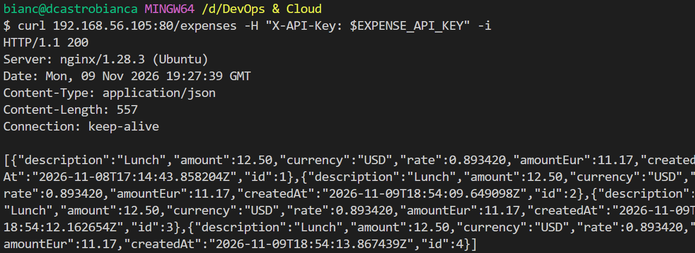
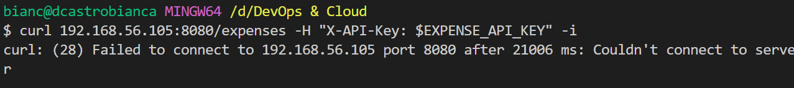
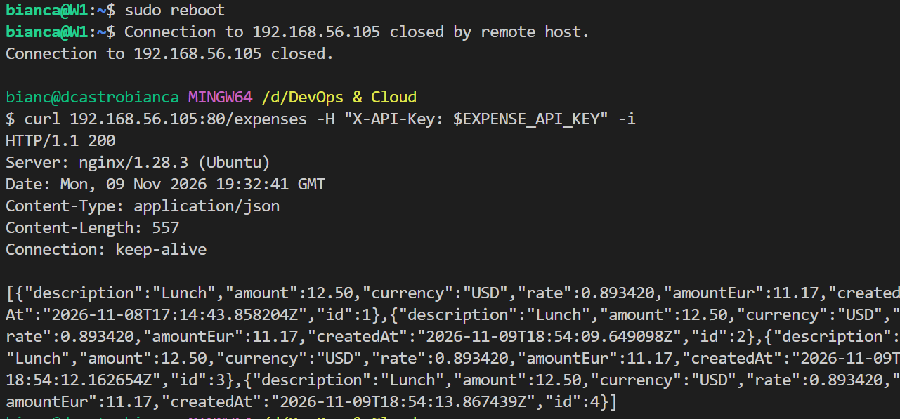

# Week 3: Networking and failure drills on the Linux VM

**Dates:** Nov 2 - Nov 6, 2026
**Status:** Done

## Goal

Put the expense app behind nginx as a reverse proxy, close the app's own port to outside traffic, back up and restore the database, and run network failure drills from Windows. By Friday the app is reachable only through nginx, I can restore the database from a backup, and I can tell a stopped app (502) from a stalled app (504) using the logs.

This is the second half of the manual deployment. Week 2 left the app running on the VM and reachable directly on port 8080, which is the gap this week closes.

By Friday I should be able to repeat the whole setup from my own notes.

## Environment

| Item | Value |
|---|---|
| Host | Windows 11 Home |
| Hypervisor | VirtualBox |
| Guest OS | Ubuntu Server (LTS) |
| VM network | Adapter 1: NAT (internet access). Adapter 2: Host-only (access from Windows). |
| New this week | nginx as reverse proxy, ufw firewall, pg_dump and pg_restore, nginx error log |

## Daily plan

Each session is 60 minutes: 10 minutes concept check, 40 minutes hands-on, 10 minutes of documentation, ending with a commit. Foundation reading, where needed, is done before the session.

| Day | Outcome | Done when | Status | Log |
|---|---|---|---|---|
| Mon | nginx runs as a reverse proxy in front of the app | From Windows, the app answers through nginx on port 80 | Done | `day-11-nginx-reverse-proxy.md` |
| Tue | The app's own port is closed to outside traffic | The app's own port is unreachable from Windows; the app still answers through nginx | Done | `day-12-firewall.md` |
| Wed | The database is backed up and restored | The database is restored from a dump; the app works afterwards | Done | `day-13-database-backup-restore.md` |
| Thu | Network failure drills | A stopped app returns 502, a stalled app returns 502 with error message, and the logs show each cause | Done | `day-14-failure-drills.md` |
| Fri | Break it and fix it, week demo | After a VM reboot the app is back through nginx without a manual start; the README "On repeat" section repeats the whole setup | Done | `day-15-week-demo.md` |

## Demo

1. Access from windows on port 80

    `curl 192.168.56.105:80/expenses -H "X-API-Key: $EXPENSE_API_KEY" -i`

    

2. Access from windows on port 8080

    `curl 192.168.56.105:8080/expenses -H "X-API-Key: $EXPENSE_API_KEY" -i`

    

3. Restart VM and run tests

    `sudo reboot`

    wait VM restart

    `curl 192.168.56.105:80/expenses -H "X-API-Key: $EXPENSE_API_KEY" -i`

    


## What I learned

- Key concepts:
    *  Configure proxy server with Nginx to have single entry point. 

    * Difference between site-available and sites-enables for Nginx servers.

    * Firewall rules

        |Rule|	Direction|	Why it exists|
        |-|-|-|
        |allow ssh|	incoming |	Remote management of the VM|
        |allow 80 |	incoming |	Windows reaches the app through nginx|
        |default deny|	incoming|	Anything without an explicit allow is closed, including the app’s port 8080|
        |default allow|	outgoing|	The rate service and package updates need outbound access|

    * Database backup:

        How to use `pg_dump` to create a plain-text file of SQL statements that can be used to create a the database in the same state as it was at the time of the dump. It is stored in a simple sql file, and differently from a physical copy, can be used in newer versions of PostgreSQL and different system architecture. 
        
        Commands example:        
        * `pg_dump dbname > dumpfile`: create a backup file

        * `psql -X dbname < dumpfile`: applies the sql commands to recreate the database. 

        My VM:
        * Backup: `pg_dump -h localhost -U expense_app -d expense_app_db -f backup-<date>.sql` (use -h localhost, because the socket connection uses peer authentication and fails for this role).

        * Where: `/home/bianca/`, outside the PostgreSQL data directory.

        * Restore: `psql -X --set ON_ERROR_STOP=on expense_app_db_2 < backup-2026-11-04.sql -h localhost -U expense_app`


- Commands I now know without looking them up:
    * systemclt status <service-name>
    * sudo systemctl start/restart/stop <service-name>
    * journalctl -u <service-name> -n <number-of-logs>
    * ss -tlnp
    * psql -h localhost -d <database> -u <user>
    * sudo ufw status verbose/numbered

- What I got wrong first:
    * Creating a backup without using  `-h localhost`. Password authentication applies to TCP connection, while peer authentication applies to Unix domain sockets. Without `-h`, pg_dump connects through the Unix socket at `/var/run/postgresql/`. As the db user doesn't match my Linux user, the connection fails. 

## On repeat

1. Install postgres

    `sudo apt upgrade`

    `sudo apt install postgresql`

    `psql --version`

    `pg_lsclusters`

    `systemctl status postgresql@<version>-main`

2. Create DB user

    `sudo psql -u postgres`

    `CREATE ROLE expense_app LOGIN NOSUPERUSER NOCREATEDB NOCREATEROLE;`

    `\password expense_app`

    `\du`

3. Create database

    `CREATE DATABASE expense_app_db OWNER expense_app;`

    `\l`

4. Test connection for database

    `psql -h localhost -d expense_app_db -U expense_app`

    `SELECT current_user, current_database();`

    `\conninfo`

    `ss -tln | grep 5432`

5. Check connection from windows

    `Test-NetConnection 192.168.56.105 -Port 5432`

    ping succeeded but connection fail. 

6. Create secrets file

    `sudo mkdir -p /etc/expense-api`

    `sudo install -m 600 -o bianca -g bianca /dev/null /etc/expense-api/expense-api.env`

    `set a-`
    `sudo source /etc/expense-api/expense-api.env`
    `set a+`

    `[ -n "$EXPENSE_API_KEY" ] && echo set || echo missing`
    `[ -n "$DB_PASSWORD_EXPENSE" ] && echo set || echo missing`

7. Install Java and Maven

    `sudo apt install openjdk-25-jdk-headless`

    `java -version`

    `sudo apt instal maven`

    `mvn -version`

8. Build jar

    `git clone https://github.com/dcastrobianca/basic-expense-app.git`

    `cd basic-expense-app/expense-api`

    `mvn package`

    `java -jar target/expense-api.jar`

9. Test app from windows.
    * GET /actuator/health returns 200

        `curl <vm-ip>:8080/actuator/health`

    * POST /expenses returns 201

        `curl -X POST <vm-ip>:8080/expenses -H "X-API-Key: $EXPENSE_API_KEY" -H 'Content-Type: application/json' -d '{"description":"Lunch","amount":12.50,"currency":"USD"}'`

    * GET /expenses returns 200
        `curl <vm-ip>:8080/expenses -H "X-API-Key: $EXPENSE_API_KEY"`

    * GET /expenses without api-key returns 401

        `curl -i <vm-ip>:8080/expenses`

10. Move jar file to path following convetion and set file permission: root-owned and world-readable

    `sudo mkdir -p /opt/expense-api`

    `sudo mv ~/basic-expense-app/expense-api/target/expense-api.jar /opt/expense-api/`

    `sudo chown root:root /opt/expense-api/expense-api.jar`

    `sudo chmod 644 /opt/expense-api/expense-api.jar`

11. Set permission to secret file: read/write by root only

    `sudo chown root:root /etc/expense-api/expense-api.env`

    `sudo chmod 600 /etc/expense-api/expense-api.env`

12. Create user to run app

    `sudo useradd --system --no-create-home --shell /usr/sbin/nologin expense-api`

13. Create expense-api service definition

    `sudo nano /etc/systemd/system/expense-api.service`

    ```
        [Unit]
        Description=Expense API
        After=network.target postgresql.service

        [Service]
        User=expense-api
        EnvironmentFile=/etc/expense-api/expense-api.env
        ExecStart=/usr/bin/java -jar /opt/expense-api/expense-api.jar
        SuccessExitStatus=143
        Restart=on-failure
        RestartSec=5

        [Install]
        WantedBy=multi-user.target
    ```
14. Start new service

    `sudo systemctl daemon-reload`

    `sudo systemctl enable --now expense-api`

15. Check service logs and status

    `systemctl status expense-api`

    `journalctl -u expense-api -o cat --no-page`

    Run tests from step 9. 

    `sudo reboot`

    `systemctl status expense-api`

    `journalctl -u expense-api -o cat`

    App should be running and db should have kept data after reboor. 

16. [OPTIONAL] Crash tests
    * Service ends abruptly

        `systemctl show -p MainPID --value expense-api`

        `sudo kill -9 <pid>` to end service abruptly

        `systemctl status expense-api`

        `journalctl -u expense-api -o cat --no-page`

        App should recorver from it alone.

    * Database down

        `sudo systemctl stop postgresql@18-main`

        `systemctl status postgresql@18-main`

        GET /expenses should return error 500 

        GET /actuator/health should return DB down.

        `sudo systemctl start postgresql@18-main`

        `systemctl status postgresql@18-main`

        App should be able to connect to DB without interference after postgresql service is started.
    
    * App's port busy

        `sudo systemctl stop expense-api`

        `ss -tlnp | grep 8080`  should show port busy with nc

        `systemctl status expense-api` : should show activation

        `journalctl -u expense-api -o cat -n 30`: should show port 8080 already used. Application cannot completly start and keeps retrying.

        after port is free, the app should be able to start without any interference.

    * Jar file with wrong permission

        `sudo chmod 600 /opt/expense-api/expense-api.jar`

        `sudo -u expense-api test -r /opt/expense-api/expense-api.jar && echo readable || echo not readable`

        `systemctl status expense-api`: should show activating

        `journalctl -u expense-api -n 15 --no-pager`: should show jar file unaccessible error.

        After permission is fixed, app should be able to start without interference. 

        `sudo chmod 644 /opt/expense-api/expense-api.jar`

17. Remove Nginx default symlink 

    `ls -l /etc/nginx/sites-enabled/`

    `sudo rm /etc/nginx/sites-enabled/default`

18. Set up proxy server
    * Create app's server config

        `sudo nano /etc/nginx/sites-available/expense-api`
            
        ```
            server {
                location / {
                    proxy_pass http://localhost:8080;
                }
            }
        ```
    * Create symlink to app's config

        `sudo ln -s /etc/nginx/sites-available/expense-api /etc/nginx/sites-enabled/expense-api`

    * Reload Nginx configuration

        `nginx -s reload`

19. Run tests from Windows, repeating step 9, but use port `80` instead of `8080`. Both ports should return the same result. 

20. [OPTIONAL] Crash test

    `sudo systemctl stop expense-api`

    App service is down, should immediately return error 502. 

    `sudo systemctl start expense-api`

    After app's service is restarted should run normally from port 80, without manual interference.

21. Configure firewall to allow only traffic through port 80. Port 8080 should be blocked for requests outside from VM.
    * Check current status. should be inactive.

        `sudo ufw status verbose` should show inactive.

        `less /etc/services` list services

    * Allow outbound traffic to ssh and port 80 only. 

        `sudo ufw allow ssh`
        
        `sudo ufw allow 80`
    * Activate firewall.

        `sudo ufw enable`

        `sudo ufw status verbose`

    * Run tests from Windows, repeating step 9, using port 80 and port 8080. Port 80 should works. Port 8080 should return 'Couldn't connect to server' 

    * Start a new ssh connection to VM, should be possible. 

    * Restart VM and the last two steps should have the same result.

        `sudo reboot`

22. Create database backup

    `pg_dump -h localhost -U expense_app -d expense_app_db -f backup-2026-11-09.sql`

    `realpath backup-2026-11-09.sql`

23. Create new database using backup.

    `sudo -u postgres psql`

    `CREATE DATABASE expense_app_db_2 OWNER expense_app;`

    `\q`

    `psql -X --set ON_ERROR_STOP=on expense_app_db_2 < backup-2026-11-09.sql -h localhost -U expense_app`

    `psql -h localhost -U expense_app -d expense_app_db_2`

        ```sql
            SELECT current_user, current_database();

            \dt

            SELECT * from expense;
        ```

    should show all rows from previous database.

    `\q`

24. [OPTIONAL] Test app's connection to new db

    * Change DB_URL using env file
        `sudo nano /etc/expense-api/expense-api.env`

        add: `DB_URL=jdbc:postgresql://localhost:5432/expense_app_db_2`

    * Restart service

        `sudo systemctl restart expense-api`

        `journalctl -u expense-api -o cat -n 50 --no-page`

    * Run tests from step 9 with port 80. Same expenses should be listed.

    * Revert database to original removing change to file expense-api.env from this step.

25. [OPTIONAL] Network drills
    * Tests base line: step 9 with port 80.

    * App service is down. Should return error 502 immediately. 
        
        `sudo systemctl stop expense-api`

        `systemctl status expense-api`

        run baseline tests: erro 502. 

        `nano /var/log/nginx/error.log`: Nginx logs should show "Connection refused" error.

        `sudo systemctl start expense-api`

        `systemctl status expense-api`

        After app's service restarts, baseline tests shows no error whtout any manual interference. 

    * Block outbound access to the rate service with a firewall rule

        `getent ahosts api.frankfurter.dev`

        `ss -tn state established '( dport = :443 )'` - check which ip is actually being used. 

        `grep IPV6 /etc/default/ufw` - check if firewall wules are active also for IPv6.

        `sudo ufw deny out to <ip-address> port 443 proto tcp` - block all ip from previous list. 

        `sudo systemctl restart expense-api`

        Run baseline request POST /expenses. Should return 502 after timeout with error "Exchange rate service unavailable"

        `journalctl -u expense-api -o cat --no-page -n 6`: shows connecion timerout to rate service.

        `sudo tail -n 5 /var/log/nginx/error.log`: shows no new logs, only the ones from last drill.

        `sudo ufw status numbered` - check rules for blocking rate service api

        `sudo ufw delete <rule-number>` - delete all rules except for ssh and port 80.


## Weekly review

- Planned outcomes met: _pending_ of 5.
- What to change next week:
    * _pending_