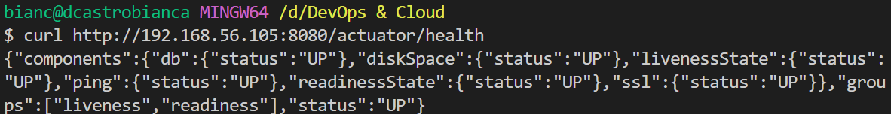
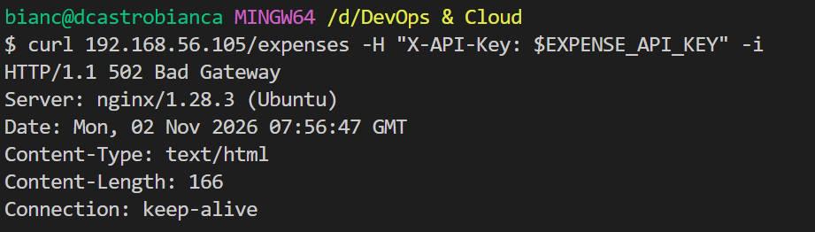
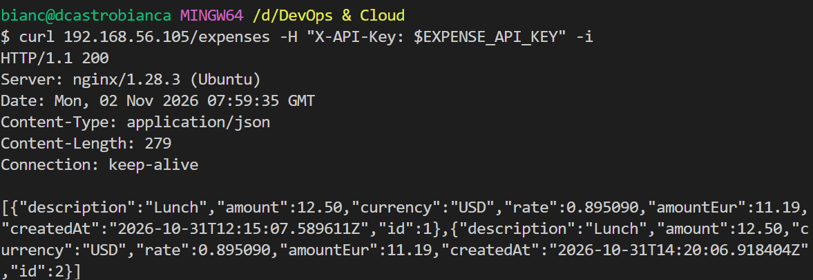

# Day 11: Nginx as reverse proxy

**Outcome:** From Windows, the app answers on port 80 through nginx.

**Done when:** 
1) A request from Windows to the VM on port 80 returns the app's response through nginx. 
2) With the app stopped, nginx returns an error response (not a timeout). 
3) The nginx site configuration is documented

## What I did
1. Tests access to application service from Windows
    `http://192.168.56.105:8080/actuator/health`

    

2. Set up proxy server
    * Create server file 

        `sudo nano /etc/nginx/sites-available/expense-api`
        
        ```
            server {
                location / {
                    proxy_pass http://localhost:8080;
                }
            }
        ```

    * Create symlink to expense-api server configuration

        `sudo ln -s /etc/nginx/sites-available/expense-api /etc/nginx/sites-enabled/expense-api`

        Nginx only loads what's configured as a symlink in sites-enabled. This way is possible to turn sites on and off without deleting it's configuration. Each site is isolated and `/etc/nginx/nginx.conf` holds only global settings. 

    * Check symlink

        `ls -l /etc/nginx/sites-enabled/`

        By default, Nginx has a server definition and a symlink on por 80. To be able to access my app using port 80, I also need to remove default symlink.

        `sudo rm /etc/nginx/sites-enabled/default`

    * Reload configuration

        `nginx -s reload`

        `sudo systemctl reload nginx`

    * Access service from Windows

        * `curl <ip>`: returns Error 404, as this path is not part of my application's configured endpoints.
        * `curl http://192.168.56.105/actuator/health`: retuns services status
        * `curl 192.168.56.105/expenses -H "X-API-Key: $EXPENSE_API_KEY"`: returns list of expenses saved in database.

3. Service unavailable returns error
    * Stop expense-api service

        `sudo systemctl stop expense-api`

    * Send request using proxy server from windows

        `curl 192.168.56.105/expenses -H "X-API-Key: $EXPENSE_API_KEY" -i`

        

    * Restart expense-api service. Should be accessible without touching Nginx

        `sudo systemctl start expense-api`

        `curl 192.168.56.105/expenses -H "X-API-Key: $EXPENSE_API_KEY" -i`

        

## What worked
1. My service having it's own server configuration in `/etc/nginx/sites-available`. This way, the service configuration is independent from any other I might need to add in the future, and can be disable without deleting the configuration using symlink.

## What did not work

1. Set up proxy server directly in nginx.conf
    * Edit nginx configuration

        `sudo nano /etc/nginx/nginx.conf`

        Add in http contect
        ```
            server {
                location / {
                    proxy_pass http://localhost:8080;
                }
            }
        ```
    
## How I solved it
1. Nginx has a default server for port 80 configured in `/etc/nginx/sites-available` with the symlimk `default` in `/etc/nginx/sites-enabled`. To fix, I just need to remove the symlink, so the port 80 server configuration would come from nginx.conf. 

    `sudo rm /etc/nginx/sites-enabled/default`

    In my end solution, I prefered to follow the good practices and create a service configuration for my application and keep `nginx.conf` for global configurations only.

## What I would do differently