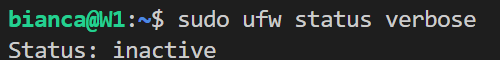
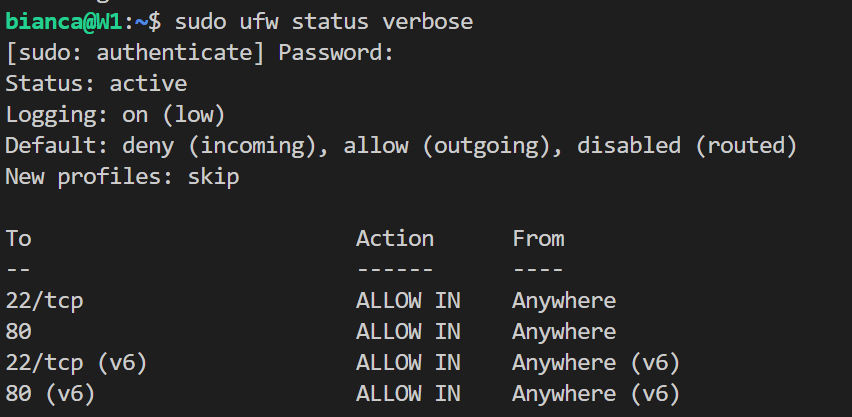
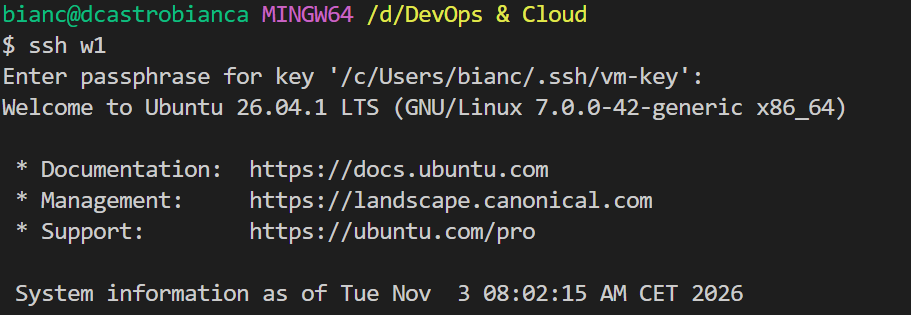
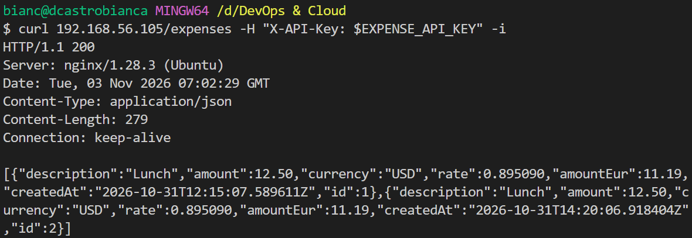
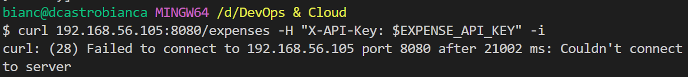
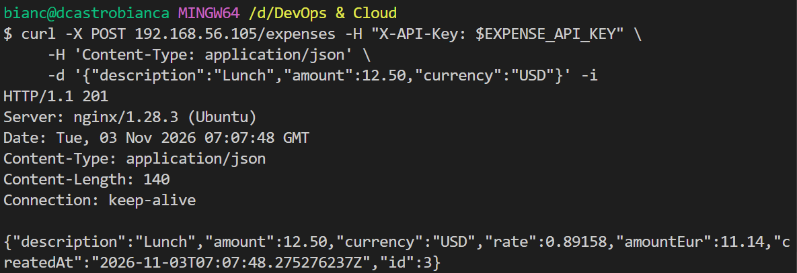
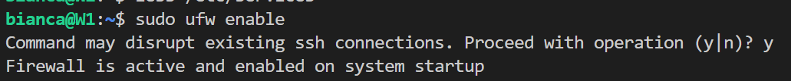

# Day 12: Firewall

**Outcome:** Only ssh and port 80 are open to Windows, the app's own port is closed to the outside, and outbound access to the rate service still works.

**Done when:** 
1) ssh still works after the firewall is on. 
2) Port 80 answers from Windows; the app's own port from Windows is refused. 
3) The app still reaches the external rate service. 
4) README lists the rules and explains each one.

## What I did
1. Check current firewall state

    `sudo ufw status verbose`

    

2. Allow SSH connection

    * Check list of services

        `less /etc/services`
    * Allow ssh based on name

        `sudo ufw allow ssh`

3. Allow connection on port 80

    `sudo ufw allow 80`

4. Enable firewall

    `sudo ufw enable`

    `sudo ufw status verbose`

    

5. Check firewall
    * Connection to VM using ssh. 

        Still possible, even with firewall enabled.

        

    * GET /expenses request to port 80

        Request returns 200 and list of expenses, as expected.

        

    * GET /expenses request to port 8080

        Timeout before connection to the server, with error "Failed to connect to localhost port 8080 after 2205 ms: Couldn't connect to server", as expected by default deny incoming traffic rule.

        

        `sudo ss -tlnp | grep 8080` shows that java is using the port 8080, so the connection was blocked by firewall. 

    * POST /expense request. App can still connect to external rate service

        Returned 201, which means it managed to still connect to rate service, as it was expected by default allow outgoing trafic rule. 

        

    * Reboot system and do tests again. After system reboot, the firewall rules were kept and I had the same result as the tests previously to reboot.

## What worked
1. Enable ssh port before enabling firewall. I got a warning that enabling might effect existing ssh connection, so if I didn't allowed ssh connectin before enabling it, I might have got kicked out of VM.

    

## What I would do differently
1. I added both rules withour number. If a rule is added after this configuration with `ufw insert 1 ...` and affects ssh port, I could be locked out of my VM. To avoid this specific problem I'd do `sudo ufw insert 1 allow ssh` and don't add any rule above it that might block ssh connect.