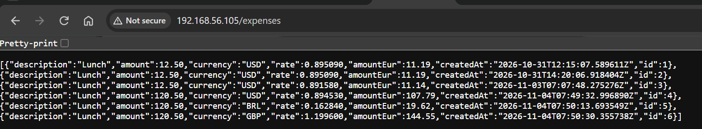
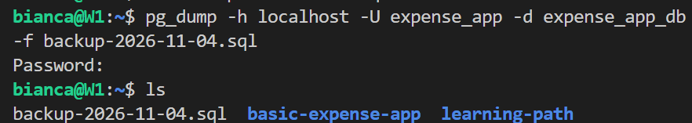
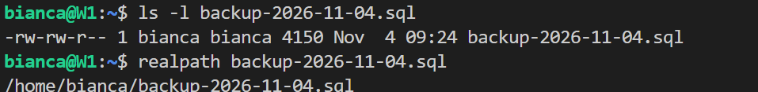
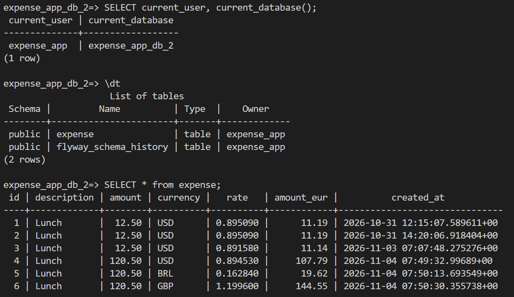
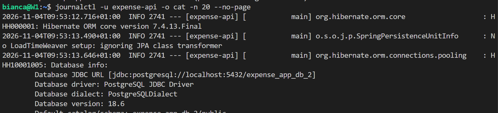
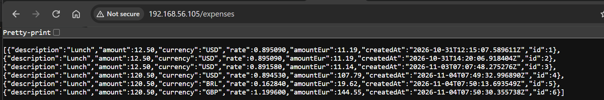
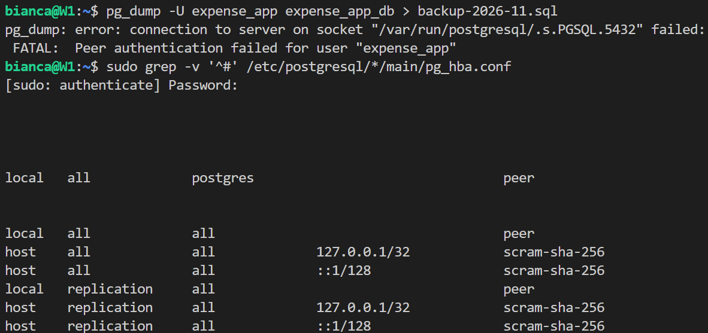

# Day 13: database backup and restore

**Outcome:** A backup of the app database can be restored into an empty database.

**Done when:** 
1) A backup file exists outside the database's data directory. 
2) After restoring into a new database, it brings the same rows back. 
3) README states how the backup is taken and where it is kept.

## What I did
1. Added a few expenses to database

    

2. Create database backup

    `pg_dump -h localhost -U expense_app -d expense_app_db -f backup-2026-11-04.sql`

    

    Backup file was store in `/home/bianca/backup-2026-11-04.sql`.

    

3. Create a new database
    * Login as superuser

        `sudo -u postgres psql`

    * Create db

        `CREATE DATABASE expense_app_db_2 OWNER expense_app;`

4. Restore from backup file
    * Restore 

        `psql -X --set ON_ERROR_STOP=on expense_app_db_2 < backup-2026-11-04.sql -h localhost -U expense_app`

    * Check new DB status

        `psql -h localhost -U expense_app -d expense_app_db_2`

        ```sql
            SELECT current_user, current_database();

            \dt

            SELECT * from expense;
        ```

    

5. Make app connect to new DB

    * Change DB_URL using env file
        `sudo nano /etc/expense-api/expense-api.env`

        `DB_URL=jdbc:postgresql://localhost:5432/expense_app_db_2`

    * Restart service

        `sudo systemctl restart expense-api`

        `journalctl -u expense-api -o cat -n 50 --no-page`

    

6. GET /expenses shows same list

    

7. Change DB back to original one using step 5 and removing DB_URL configuration. 


## What worked
1. Keep original database until restored database status is checked. A database backup is a unverified hypothesis, and restore might fail. Only after the restore is completely done and the new db status is checked, I can be sure that the process worked. 

## What did not work
1. Creating a backup without using  `-h localhost`. 
Password authentication applies to TCP connection, while peer authentication applies to Unix domain sockets. Without `-h`, pg_dump connects through the Unix socket at `/var/run/postgresql/`. As the db user doesn't match my Linux user, the connection fails. 
    

## How I solved it
1. Using `-h localhost`, pg_dump connects over TCP, which asks for password and allows me to complete the backup. To avoid creating a file in case db backup fails, I also changed `> backup-2026-11-04.sql` for `-f backup-2026-11-04.sql`.
