# Day 14: Network failure drills

**Outcome:** Two network failures are found from the logs and fixed.

**Done when:** 
1) With the app stopped, the nginx error log shows the cause, and the fix restores the page. 
2) With outbound access to the rate service blocked, POST /expenses returns 502 and the logs show why; unblocking restores it. 

## What I did
1. Run baseline request that goes though the full path: From windows, through Nginx, to app to external rate service.
    * POST /expenses should return 201

        `curl -X POST 192.168.56.105/expenses -H "X-API-Key: $EXPENSE_API_KEY" -H 'Content-Type: application/json' -d '{"description":"Lunch","amount":12.50,"currency":"USD"}'`

    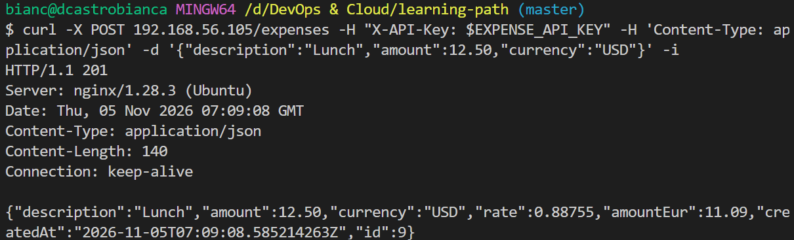
2. Stop app and find cause in Nginx logs
    * Stop app

        `sudo systemctl stop expense-api`

        `systemctl status expense-api`

    * Run baseline request. Should immediatly return 502 Error. 

        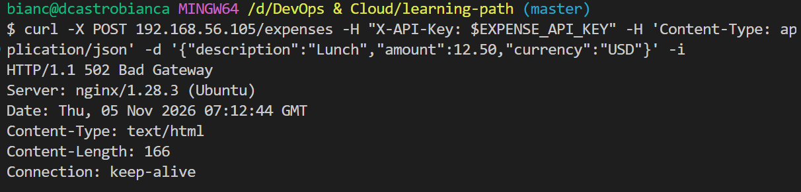

    * Check Nginx logs. Should have "Connection refused" error

        `nano /var/log/nginx/error.log`

        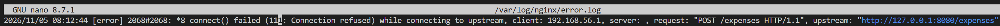

3. Restart app and run baseline test

    `sudo systemctl start expense-api`

    `systemctl status expense-api`

    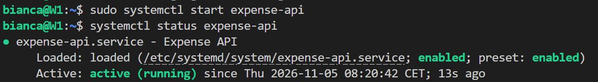

    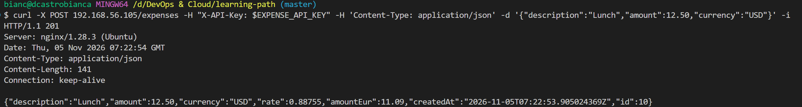

4. Block outbound access to the rate service with a firewall rule
    * Find the address the VM resolves for the rate service’s host

        `getent ahosts api.frankfurter.dev`

        Rate service is hosted by Cloudflare, which services many site and have many ip-addresses. The output also shows IPv6 addresses. 

        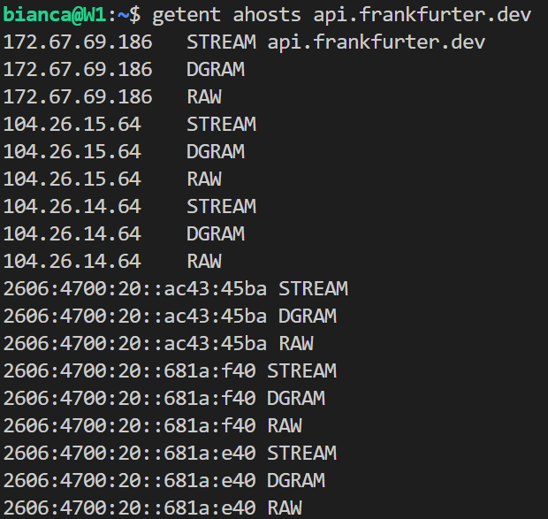

    * Confirm ufw applies IPv6 rules.

        `grep IPV6 /etc/default/ufw`

        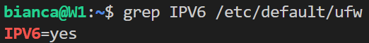

    *   Add rules to deny all ips

        `sudo ufw deny out to <ip-address> port 443 proto tcp`

        IP LIST:
            * 2606:4700:20::ac43:45ba - IPv6
            * 2606:4700:20::681a:e40  - IPv6
            * 2606:4700:20::681a:f40 - IPv6
            * 172.67.69.186 - IPv4
            * 104.26.14.64 - IPv4
            * 104.26.15.64 - IPv4

        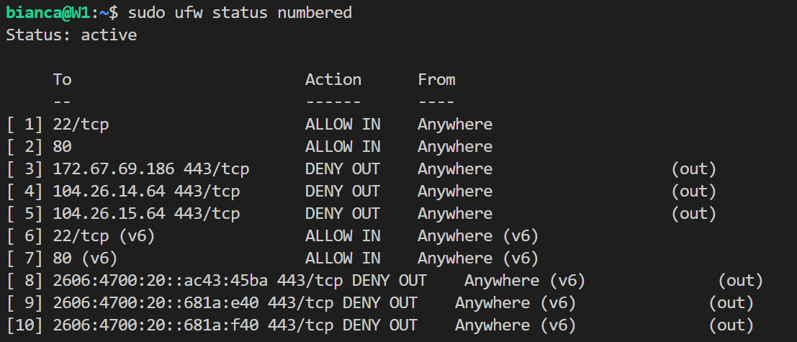

    * Restart app service to close ongoing connections
        
        `sudo systemctl restart expense-api`

    * Run baseline requests. Should return 502 after timeout

        `curl -X POST 192.168.56.105/expenses -H "X-API-Key: $EXPENSE_API_KEY" -H 'Content-Type: application/json' -d '{"description":"Lunch","amount":12.50,"currency":"USD"}' -i -w '\n%{time_total}s\n'`

        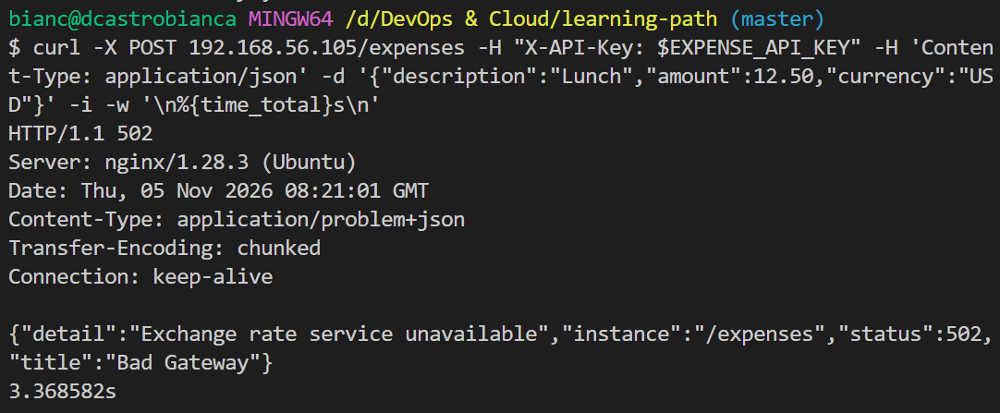

    * Check app logs. Should show timeout connecting to rate service.

        `journalctl -u expense-api -o cat --no-page -n 6`

        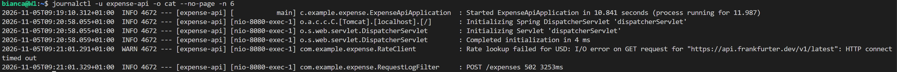

    * Check Nginx logs. There should be no logs for this error.

        `sudo tail -n 5 /var/log/nginx/error.log`

        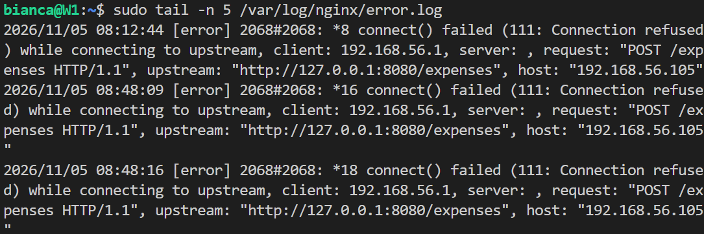

        All error logs are from previous drill. 

5. Delete firewall rules for rate service 

    `sudo ufw status numbered`

    `sudo ufw delete <rule-number>`

    Rule numbers: 10,9,8,5,4,3

    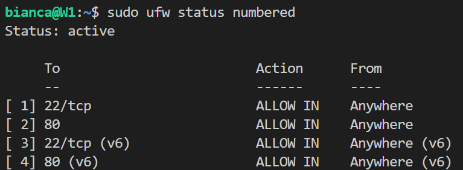

6. Run baseline test

    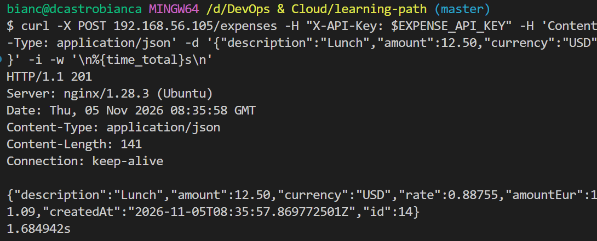

## What worked

## What did not work

1. My first attempt to find the address the VM resolves for the rate service’s host

    `getent hosts api.frankfurter.dev`

    Rate service is hosted by Cloudflare, which services many site. With this command, only IPv6 were show, and even after I blocked it, the expense-api could still connect to rate service.

## How I solved it

1. I had to check the ip address the app was actually using. 
    
    `ss -tn state established '( dport = :443 )'`

    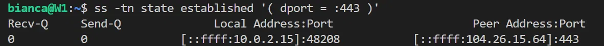

    It returned a IPv4 address written in IPv6 notation, which showed my I had blocked the wrong ips. So I listed all IPv4 addresses and blocked them, I also kept the block of IPv6 addresses.

    `getent ahostsv4 api.frankfurter.dev`

## What I would do differently
1. UFW filters by address; the rate service’s addresses change, so the block is point-in-time. Domain-based egress control needs a proxy or cloud FQDN rules, that is what I'd use in production.