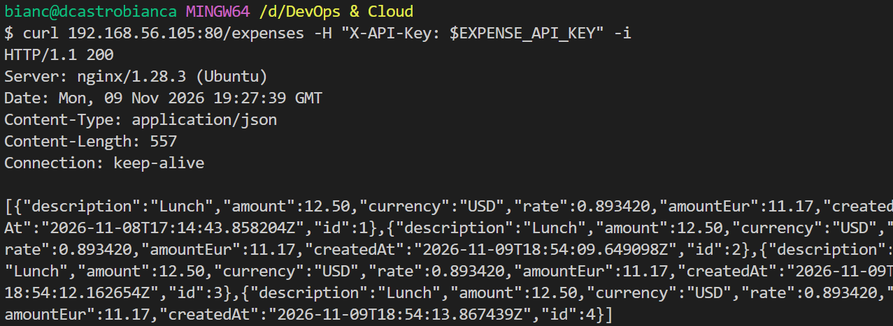
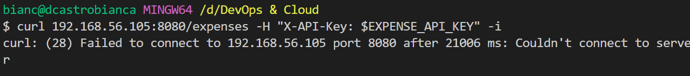
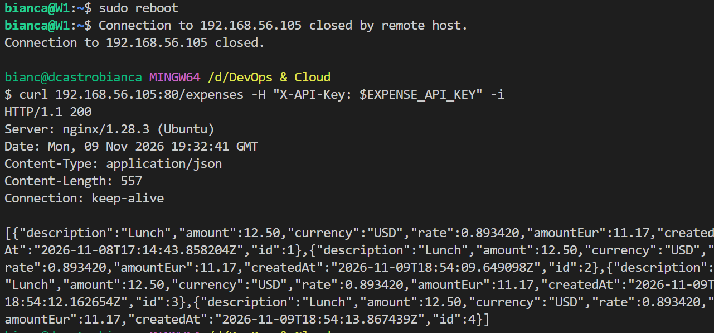
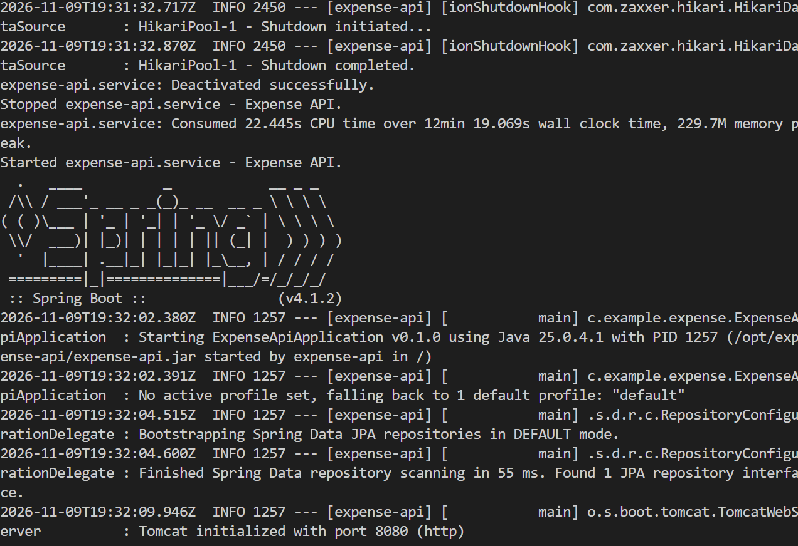

# Day 15: Week demo (break it and fix it)

**Outcome:** After a VM reboot, the app is reachable through nginx on port 80, port 8080 is blocked from Windows, and the README's On repeat list rebuilds the setup.

**Done when:**
1) After a VM reboot the app is back through nginx without a manual start.
2) Port 80 returns the expense list from Windows, and port 8080 is blocked from Windows.
3) The README "On repeat" section repeats the whole setup.

## What I did
1. Checked the app through nginx from Windows before the reboot.

    `curl 192.168.56.105:80/expenses -H "X-API-Key: $EXPENSE_API_KEY" -i`

    

2. Checked that port 8080 is blocked from Windows.

    `curl 192.168.56.105:8080/expenses -H "X-API-Key: $EXPENSE_API_KEY" -i`

    

3. Rebooted the VM and checked the app through nginx from Windows again.

    `sudo reboot`

    `curl 192.168.56.105:80/expenses -H "X-API-Key: $EXPENSE_API_KEY" -i`

    

4. Check the service after the reboot, without starting it manually.

    `systemctl status expense-api`

    `journalctl -u expense-api -o cat --no-page`

    Service status is running and logs show app initialize without any manual interference.

    

## What worked
- Port 80 returned `HTTP/1.1 200` with the expense list before the reboot (Date header 19:27:39 GMT, 4 expenses, ids 1 to 4).
- Port 8080 from Windows failed to connect: `curl: (28) Failed to connect to 192.168.56.105 port 8080 after 21006 ms: Couldn't connect to server`. The request waited about 21 seconds before failing, which is a timeout and matches the firewall dropping packets.
- After the reboot, port 80 returned `HTTP/1.1 200` with the same 4 expenses (Date header 19:32:41 GMT).

## What did not work
Nothing failed
