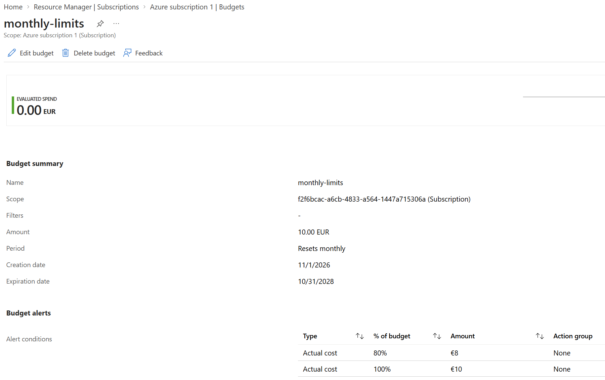
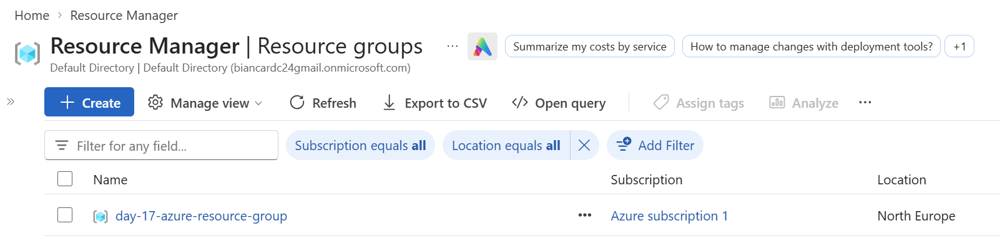
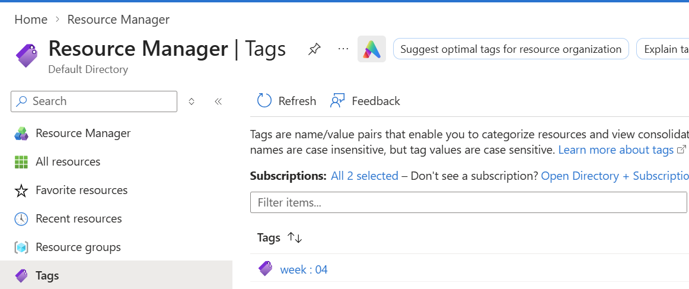
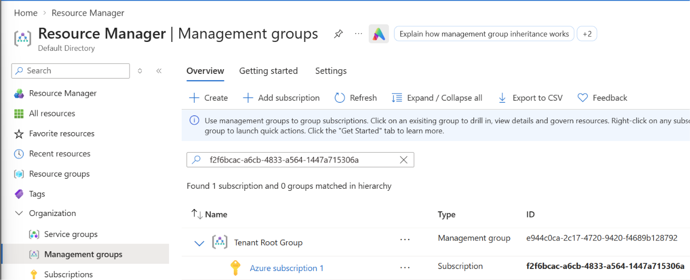
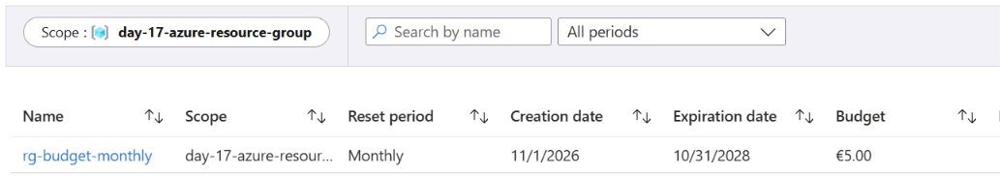

# Week 4: Azure basics, account, budget, resource hierarchy and a first VM

**Dates:** Nov 9 - Nov 13, 2026 (sessions on Mon, Tue, Wed and Thu)
**Status:** Done, 3 of 4 outcomes met. The Thursday VM session did not happen and moved to week 5.

## Goal

Set up the Azure foundation that every later stage builds on: a subscription with a spending alert, a resource group, a clear picture of where things sit in the Azure hierarchy (management group, subscription, resource group, resource), and a first Linux VM that I can reach over SSH. By Wednesday I can show, using my own resources, which level a budget and a role assignment apply to and what each one inherits. By Thursday the VM exists, I can connect to it, and it is stopped so that it does not use my free credit.

I set the budget before creating anything that costs money. The VM is the only resource this week that can cost money, and it was planned for the last day, after the budgets are in place.

There is no session on Friday this week, so this week has four sessions instead of five. The two long sessions (Wednesday and Thursday, 90 minutes each) pull work forward from week 5:

- Week 5: deploy the expense app on the VM I create this week, and write down what differs from the local VM.
- Week 6: repeat the VM setup with the Azure CLI, then with a first Terraform configuration.

**What changed:** the Thursday session did not happen, so the VM was not created this week. It moved to Wednesday of week 5, and the rest of week 5 shifts accordingly (see `week-05-azure-vm-expense-app/README.md`).

This is the first step from running things on my own machine to running them in the cloud. The expense app from weeks 2 and 3 is not touched this week.

## Environment

| Item | Value |
|---|---|
| Host | Windows 11 Home |
| Cloud | Azure subscription (free tier), used through the Azure portal |
| Region | North Europe: among the cheaper European regions and close to Nuremberg |
| Local VM | The Ubuntu Server VM from weeks 1-3 stays off this week |
| New this week | Azure subscription, Cost Management budgets and alerts, resource groups and tags, management groups, role assignment scope (view only) |

## Daily plan

Mon and Tue are 55 minutes each: 10 minutes of foundation reading, 10 minutes of concept check, 25 minutes of hands-on work and 10 minutes of documentation. Wed and Thu are 90 minutes each: 15 minutes of foundation reading, 10 minutes of concept check, 55 minutes of hands-on work and 10 minutes of documentation. Every session ends with a commit.

| Day | Outcome | Done when | Status | Log |
|---|---|---|---|---|
| Mon | An Azure subscription I can sign in to, with a monthly budget that emails me before I overspend | I sign in to the portal and see my subscription; a monthly budget exists on the subscription with alerts at 80% and 100%; the alert emails go to my address | Done | `day-16-azure-account-budget.md` |
| Tue | A tagged resource group created in the portal | A resource group exists in a region I chose; it has at least one tag; I find it and its tag in the portal | Done | `day-17-azure-resource-group.md` |
| Wed | Every level of the hierarchy located for my own resources, where a role assignment is made identified, and a budget on the resource group | I show the resource group, its subscription and the management group above it; I show where a role assignment is made at both levels and which of my access is inherited; a budget exists on the resource group only, with an alert at 100% | Done | `day-18-azure-hierarchy.md` |
| Thu | A Linux VM in my resource group that I can reach over SSH from Windows, then stopped so it does not use my credit | The VM exists in my resource group with SSH key login; I connect from Windows and run `hostnamectl`; I name every resource created alongside the VM; the VM is stopped (deallocated) and auto-shutdown is set | Slipped: moved to Wed of week 5 | `day-19-azure-linux-vm.md` (week 5) |

Foundation reading, each done inside its session:

| Day | Reading |
|---|---|
| Mon | Microsoft Learn, "Tutorial: Create and manage budgets" |
| Tue | Microsoft Learn, "What is Azure Resource Manager?" |
| Wed | Microsoft Learn, "Understand scope for Azure RBAC" |
| Thu | Microsoft Learn, "Quickstart: Create a Linux virtual machine in the Azure portal" |

## Demo

Three of the four planned screenshots. The fourth (the VM over SSH and shown as deallocated) moves to the week 5 demo.

1. The budget on the subscription, with alerts at 80% and 100%

    

2. The tagged resource group, created in North Europe

    

    

3. The hierarchy for my own resources (Tenant Root Group > Azure subscription 1 > resource group), and the budget on the resource group

    

    

## What I learned

- Key concepts:
    * Azure scope:
        * Management group: subscriptions, and other management groups.
        * Subscription: resource groups, and the billing relationship.
        * Resource group: resources that share a lifecycle.
        * Resource: one instance of a service, such as a VM or a storage account.
    * My hierarchy: Tenant Root Group > Azure subscription 1 > the resource group from day 17.
    * Role assignments are inherited down the hierarchy. My user is Owner on the subscription, where the scope reads "This resource". On the resource group the same role reads "Subscription (inherited)": I did not assign it there, it flows down from the subscription.
    * A budget has a scope. The subscription budget covers everything in the subscription, including the resource group. The resource group budget covers only that group. From the subscription I see both budgets, from the resource group only its own.
    * Cost Management has a separate "Cost alerts" menu, but those alerts are for anomaly detection on the subscription. Budget alerts are set inside the budget wizard.
    * Region choice in a real project depends on price, latency and regulations, not only on distance.
- Portal paths I now know without looking them up:
    * Subscription: All resources > Organization > Subscriptions
    * Budget on the subscription: my subscription > Cost Management > Budgets > Add
    * Resource group and its tag: All resources > Resource groups, and All resources > Tags
    * Management group: All resources > Organization > Management groups
    * Role assignments: my subscription or resource group > Access control (IAM) > Role assignments
    * Budget on the resource group: my resource group > Cost Management > Budgets > Add
- What I got wrong first:
    * Filtering the management groups list by the parent management group ID returned nothing, even though the ID was listed. Searching by the subscription ID worked.

## On repeat

Portal steps instead of commands this week. I check the list by repeating it in a second, empty resource group.

1. Sign in to the Azure portal and find the subscription

    _menu path:_ All resources > Organization > Subscriptions

2. Create a monthly budget on the subscription

    _menu path:_ my subscription > Cost Management > Budgets > Add

3. Add alerts at 80% and 100% of the budget and set the alert email address

    _menu path:_ in the same wizard, Next > Set alerts

4. Create a resource group in a chosen region, with a tag

    _menu path:_ All resources > Resource groups > Create, then Next > Tags

5. Check the resource group and its tag

    _menu path:_ All resources > Resource groups, and All resources > Tags

6. Find the subscription and the management group above a resource group

    _menu path:_ All resources > Resource groups > my resource group, follow the link to its subscription and copy the subscription ID, then All resources > Organization > Management groups and search by the subscription ID

7. Find where a role assignment is made at resource group level and at subscription level (view only), and see which access is inherited

    _menu path:_ my resource group > Access control (IAM) > Role assignments, and the same under my subscription. On the resource group the scope reads "Subscription (inherited)", on the subscription it reads "This resource"

8. Create a budget on the resource group only, with an alert at 100%

    _menu path:_ my resource group > Cost Management > Budgets > Add > Create a budget, with the resource group as scope, then Next > Set alerts

The VM steps planned for Thursday (create the VM, connect over SSH, list the resources created with it, set auto-shutdown and deallocate) moved to the "On repeat" list of week 5.

## Weekly review

- Planned outcomes met: 3 of 4.
- Done: Mon to Wed. The Azure account and budget alert, the resource group with a tag, and the hierarchy with a budget on the resource group.
- Slipped: the Thursday Azure Linux VM session.
- What to change next week:
    * The VM session moved to Wednesday of week 5, followed by the expense app on the VM on Thursday and nginx plus the network security group on Saturday.
    * The weekly plan was rebuilt for 1h30 per day, Monday to Friday, plus a Saturday block for review and "on repeat". The sessions are 90 minutes each, with 15 minutes of foundation, a 10-minute concept check, 55 minutes of hands-on and 10 minutes of documentation.
