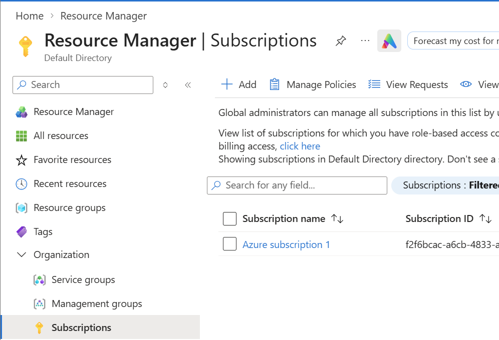
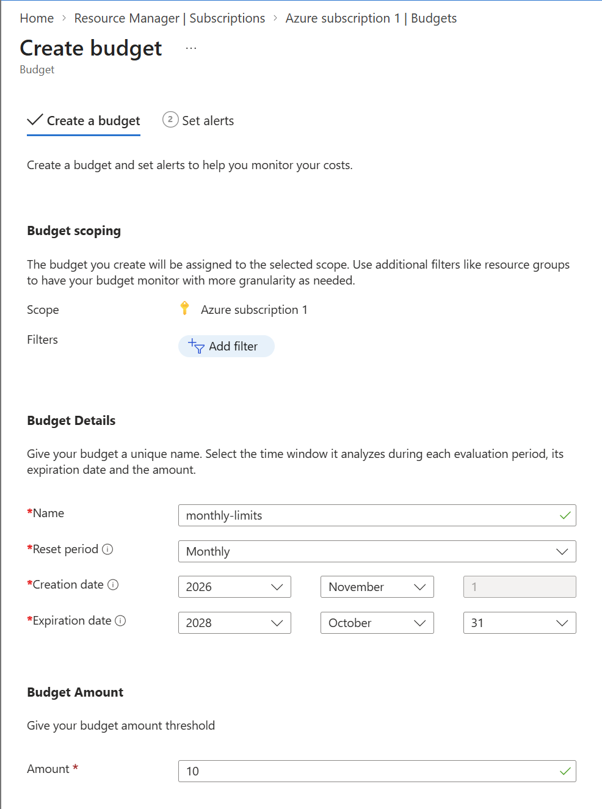
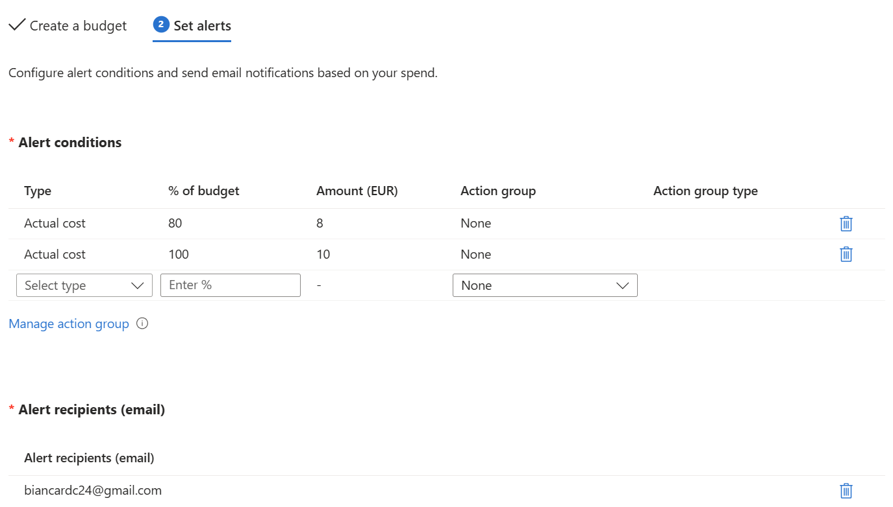
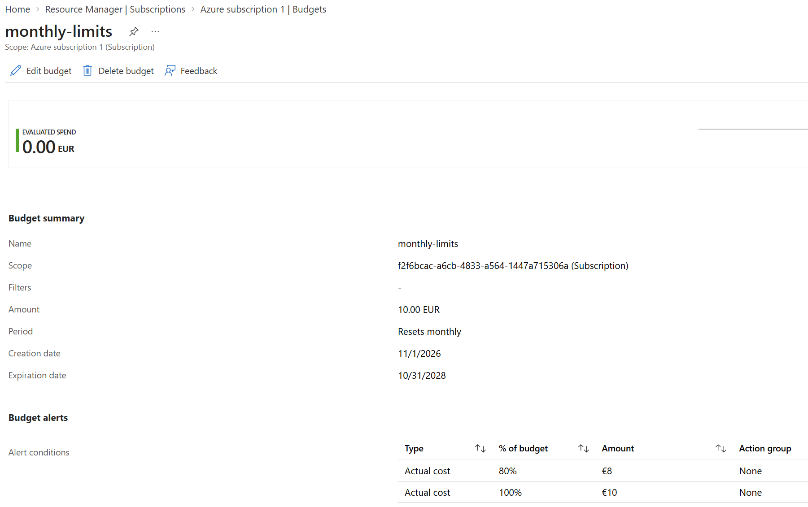

# Day 16: Azure account and budget alert

**Outcome:** An Azure subscription I can sign in to, with a monthly budget that emails me before I overspend.
**Done when:** 

1) I sign in to the Azure portal and see my subscription. 
2) A monthly budget exists on the subscription with alerts at 80% and 100%. 
3) The alert emails go to my address. 
4) The README documents what I created, what worked and what did not.

## What I did
1. Check azure subscription

    All resources > Organization > Subscriptions

    

2. Create a monthly budget
    <my-subscription> > Cost Management > Budgets > Add

    Add mandatory information: name, reset period as monthly, create and expiration data and the budget amount. 

    

3. Add alerts at 80% and 100% and send alerts to email

    Next > Set alerts: fill alert conditions. 

    * Type: actual cost

    * % of budget: 80 and 100
    * Action group: none
    * Alerts recipients : my email

    

4. Check budget on the list

    

## What worked
1. Creating budget and alerts together. There is a Cost Alert menu, but they are for anomaly dectection in subscription scope. 

## What did not work
Nothing to report here.
