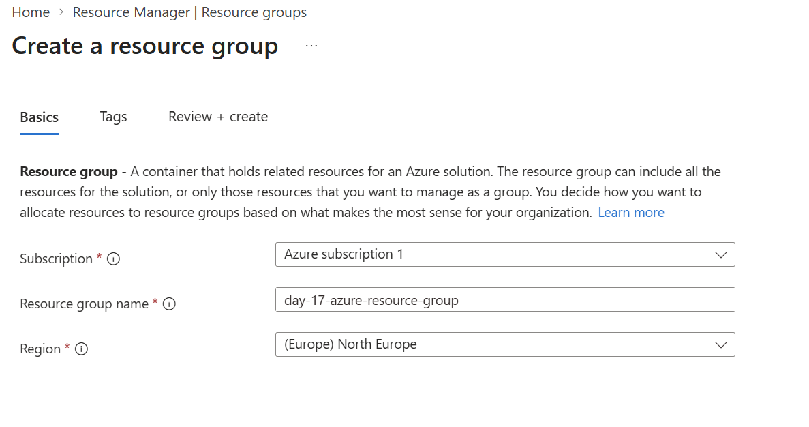
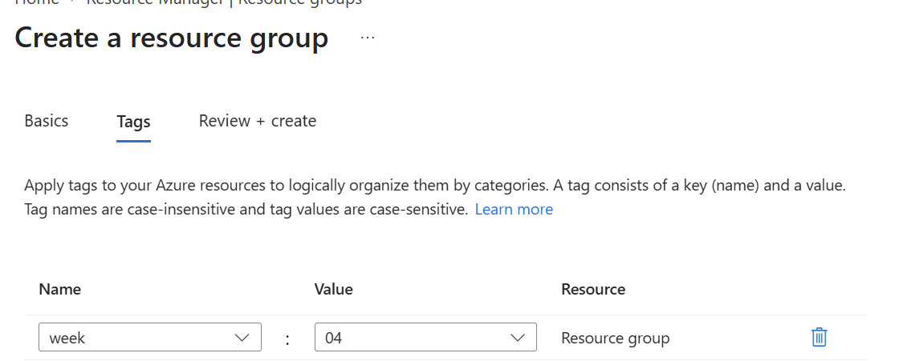
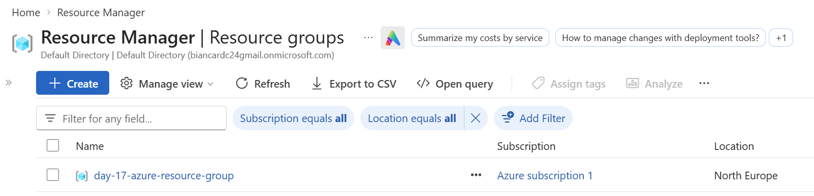

# Day 17: Azure resource group

**Outcome:** A tagged resource group created in the portal.

**Done when:** 
1) A resource group exists in a region I chose. 
2) The resource group has at least one tag. 
3) I find the resource group and its tag in the portal. 
4) The README documents what I created, what worked and what did not.

## What I did
1. Create resource group

    * All resources > Resource groups > Create

        Select subscription, name and region. I chose Noth Europe as it's a cheaper and close option, so I will pay as little as possible and not suffer from latence problems so much when compare with US options, for example. 

        

    * Next > Tag

        Add tag and value 

        

2. Check resource group  in the list
    
    All resources > Resource groups

    

3. Check Tag in the list

    All resources > Tags

    

## What worked
Creating the resource group and tag together.

## What did not work
Nothing to report here.

## What I would do differently
Choosing a region in a real scenario might depend on factor such as price, latency and also regulations. I might need to llok into these when taking this decision. 