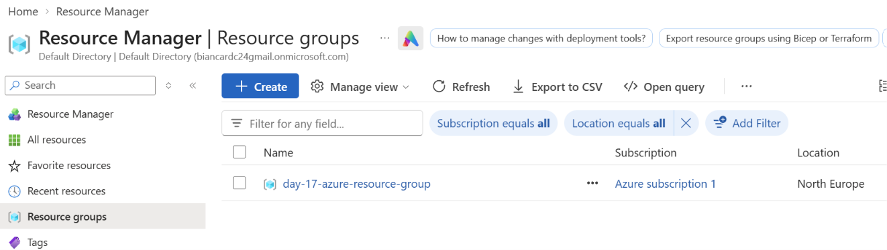
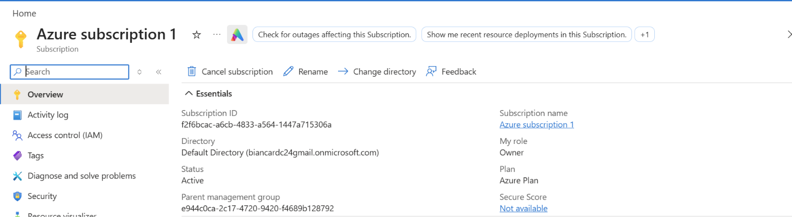
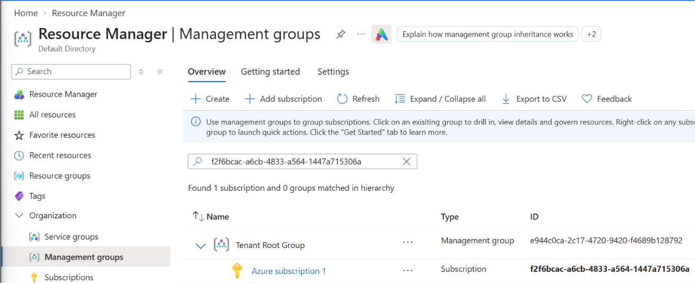
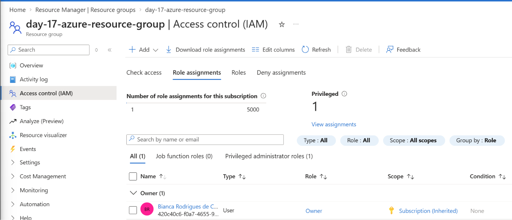
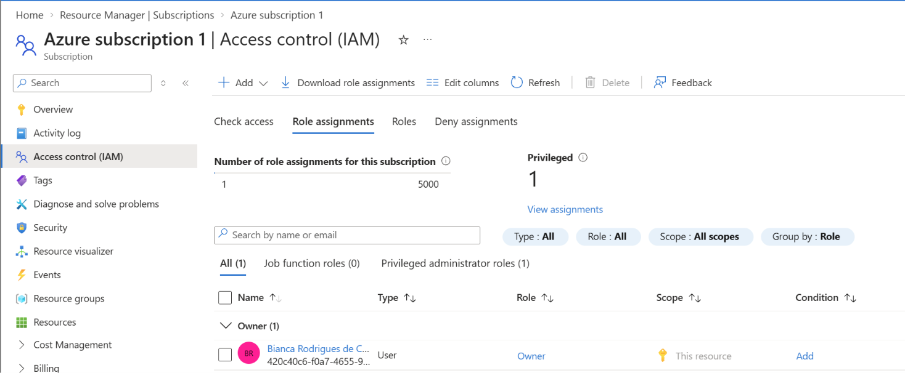
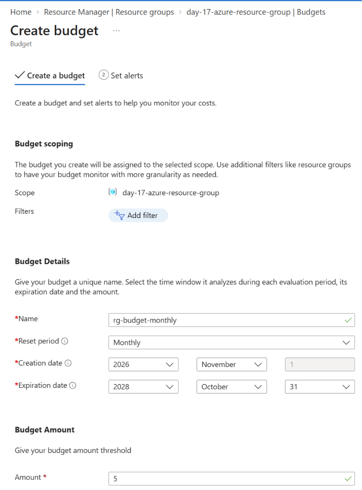
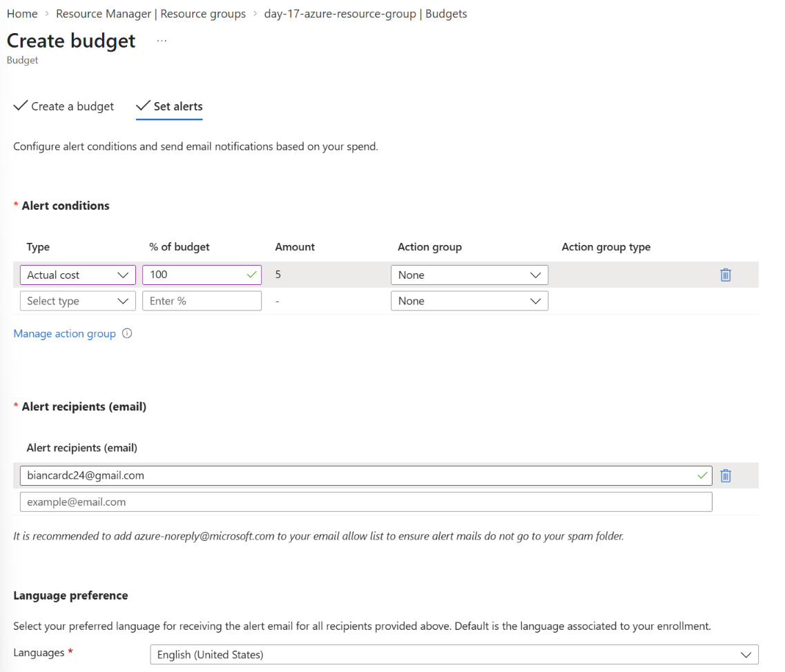
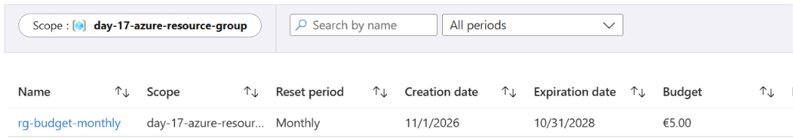

# Day 18: <topic>

**Outcome:** Every level of the hierarchy located for my own resources, where a role assignment can be made identified, and a budget scoped to the resource group created.

**Done when:** 
1) I show the resource group, its subscription, and the management group above the subscription in the portal. 
2) I show where a role assignment is made at resource group level and at subscription level (view only) and which of my access is inherited. 
3) A budget exists on the resource group only, with an alert at 100%. 
4) The README documents what I did, what worked and what did not.

## What I did
1. Find the resource group, its subscription, and the management group above the subscription in the portal

    All resources > Resource groups > list of resources

    

    there is a link to which subscription it belogns to.

    

    There I copy the subscription ID. 
    
    All resources >Organization > Management groups > List of management group > search by id 

    

2. Find where a role assignment would be made at resource group level and at subscription level (view only, assign nothing)

    * For resource group

        All resources > Resource groups > list of resources > <my-resource-group> > Access control (IAM) > Role assignaments

        

    * For subscription 

        All resources > Subscription > list of subscription > <my-subscription> > Access control (IAM) > Role assignaments

        

3. Check my own access on the subscription and on the resource group, and see which part is inherited

    In the images above, I can see my user with the role "Owner". on the subscription the scope of the role reads "This resource" while in the resource groupe the scope of the role owner reads "Subscription (inherited)".

4. Create a budget on the resource group only, with an alert at 100%

    All resources > Resource groups > list of resources > <my-resource-group> > Cost Management > Budgets > Add > Create a budget

    Add information about name, creation and expiration date, reset period and amount. The scope here needs to be the resource group name. 

    

    Next > Set alerts.

    Add Type as "Actual cost", % of budget, alert recipients (email) and language. 

    
    
    Create.

    

5. Compare it with the subscription budget: where each one is listed and what each one covers

    If I access my subscription Budget menu, I can see both budgets: the one created for subscription and the one created for the resource group. But from the resource group budget I only see it's own. The scope changes.  Subscription budget covers all that is included in the subscription, including the resource group. 

## What worked
Budget and alert configuration worked as expected so far and I could easily found my way around Azure interface.

## What did not work
1. Trying to filter in the management groups list with the parent management group ID didn't work, even if the ID was listed there.

## How I solved it
1. Instead of filtering by the parent management group ID, I used my subscription ID.
