# Day 19: Azure Linux VM in the portal

**Outcome:** A Linux VM running in my Azure resource group that I can reach over SSH from Windows, then stopped so it does not use my credit.

**Done when:** 
1) A Linux VM exists in my resource group, in the same region, with SSH key login. 
2) I connect to it over SSH from Windows and run hostnamectl. 
3) I name each resource created alongside the VM in the resource group. 
4) The VM status is stopped (deallocated) and auto-shutdown is set. 
5) The README documents what I did, what worked and what did not.

## What I did
0. Create a new Resource Group in Region "Germany West Central"

    Because of the validation error while creating the VM in Noth Europe region, I created a new Resource named week-05 in region Germany West Central, where I have quota to run VM.

    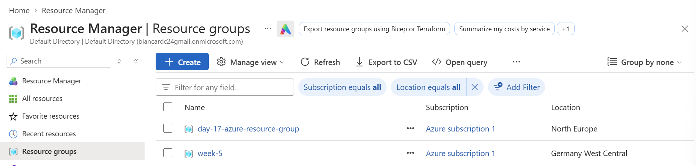

1. Create a Linux VM (Ubuntu Server LTS, smallest size available) in my resource group and region

    The following decisions were made to have the cheapest cost within my quota. 

    * Virtual machines > Create > Virtual machine > Basic

        Select subscription and resource group 

        Name: day-19-azure-linux-vm

        Select Region "Germany West Central"

        Set Availability options to "No infrastructure redundancy required"

        Select size (in my case , based on price)

        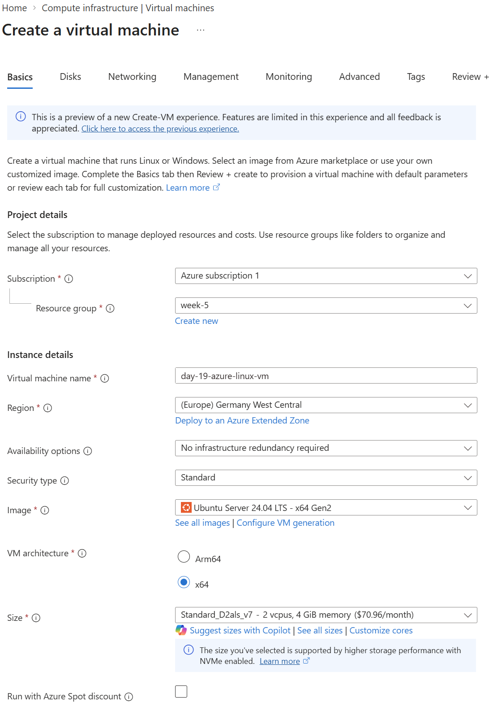

        Mark Authentication type as "SSH public key"

        Type username

        Set SSH public key source as "Generate new key pair"

        Set SSH Key type as "Ed25519 SSH Format"

        Key pair name: day-19-azure-linux-vm_key

        Public inboudn ports set to "Allow selected ports"

        Select inboud ports mark HTTP (80) and SSH (22)

        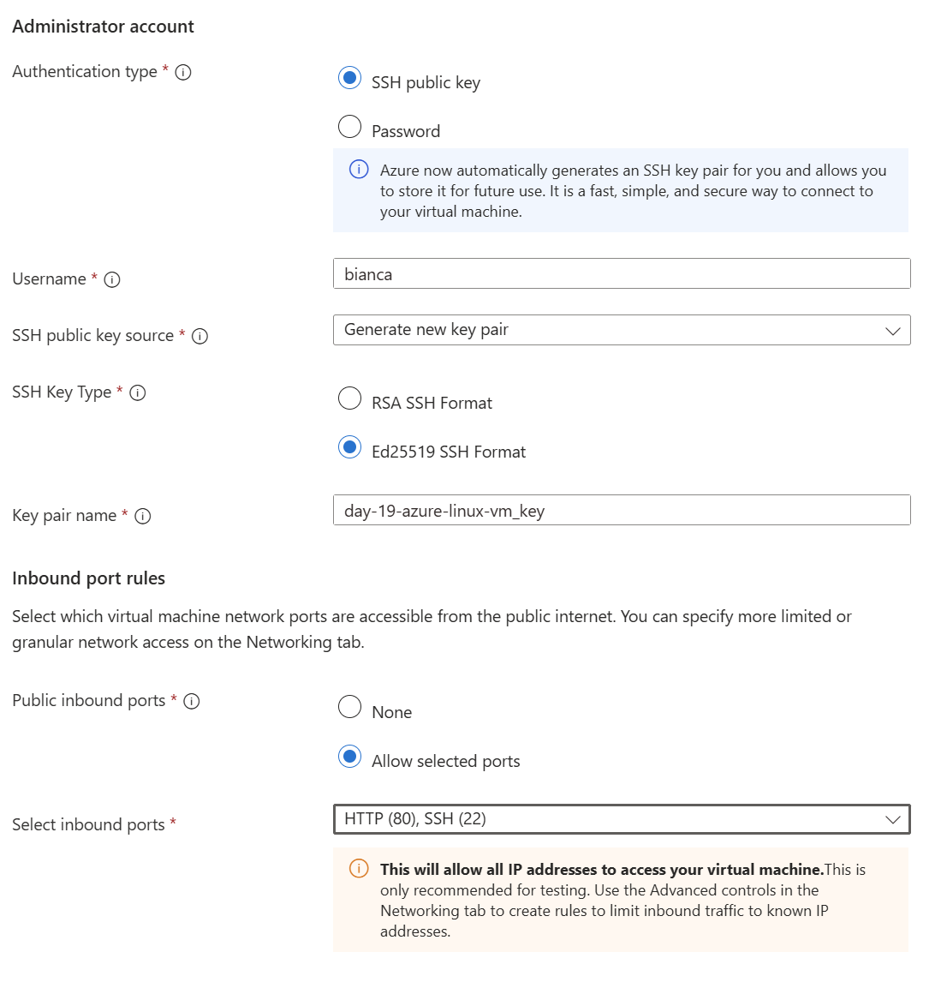
    
    * Next > Disk

        Set OS disk size to Image default

        Set OS disk type to Standard SSD

        Mark "Delete with VM"

        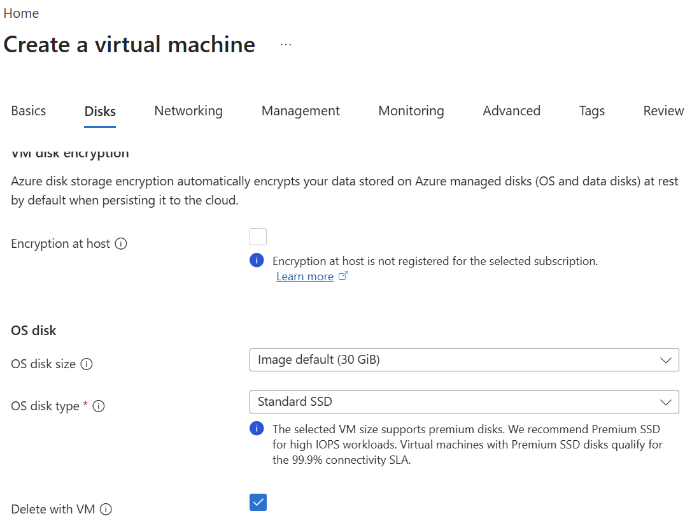

    * Next > Networking

        Mark Delete NIC when VM is deleted

        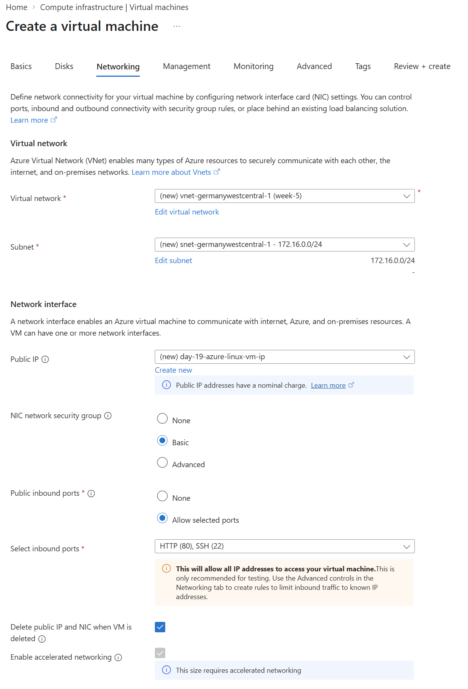

    * Next > Management > Next > Monitoring

        Mark Boot diagnostics as "Disabled"

        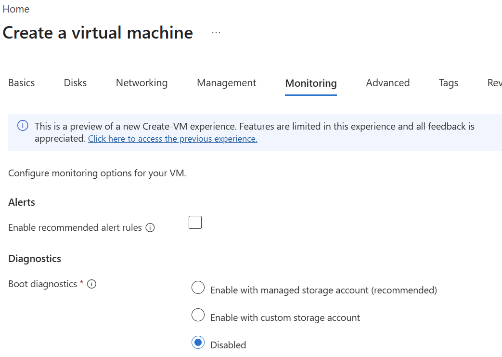

    * Review + create

        Wait for validation

        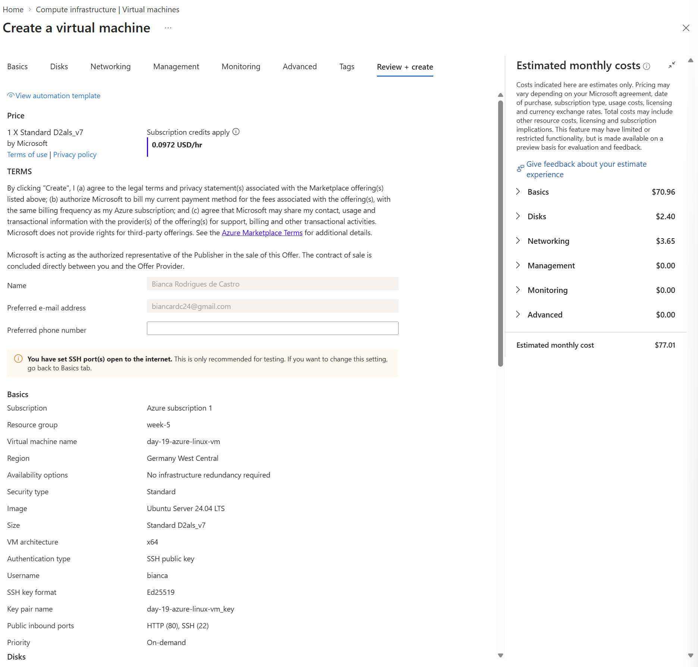

    * Create and wait for deployment of resours to be finished

        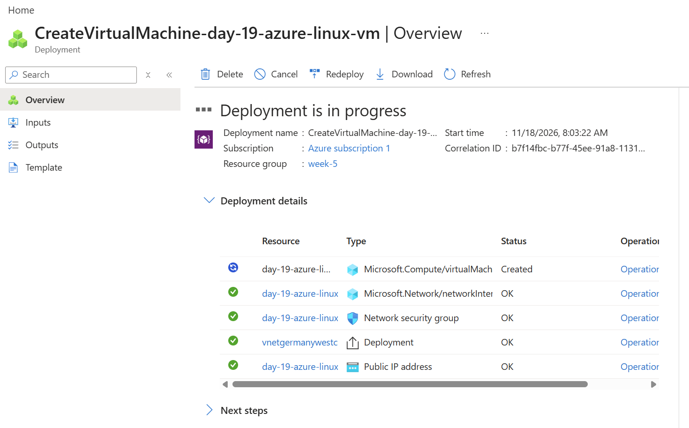

        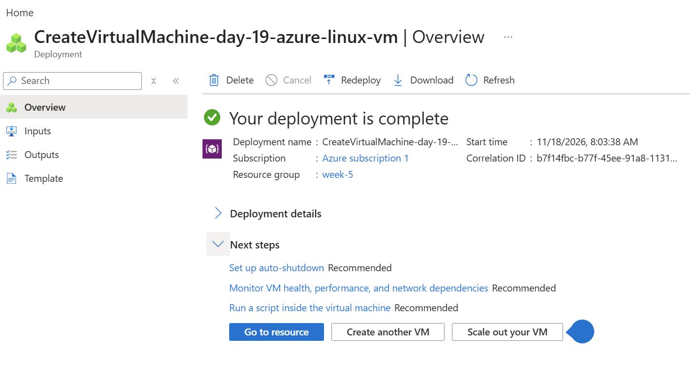

2. Use SSH key login, and allow inbound SSH only
     * Get Public IP from azure portal

        <my-vm> > Connect > Connect

        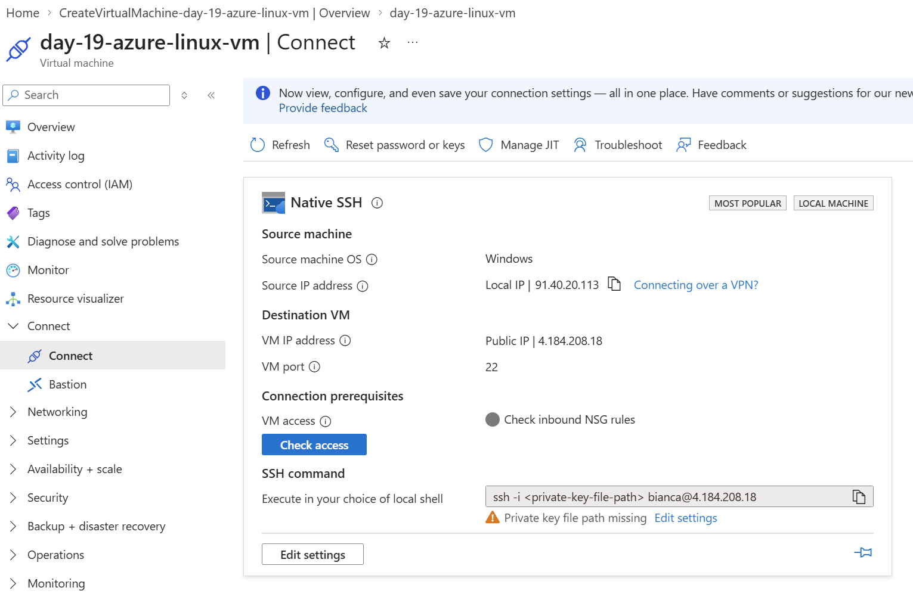

    * Remove inboud fot HTTP in port 80

        All resources > week-5 > my-network-security-group > delete rule

        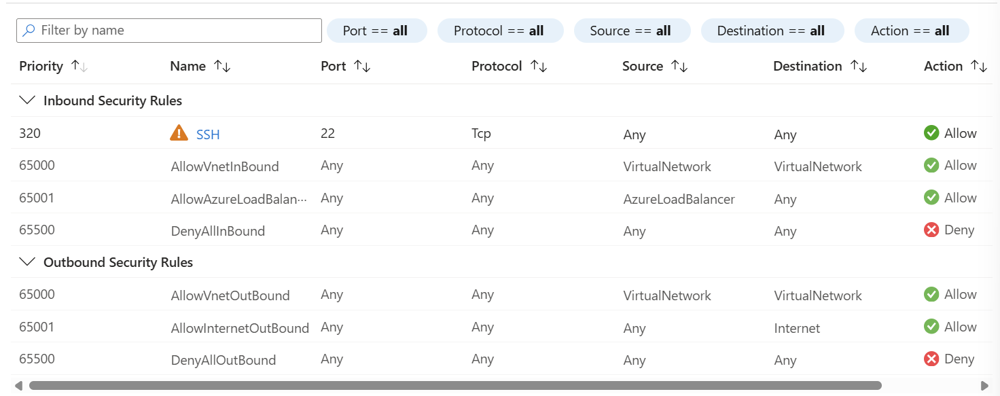

3. Connect to the VM over SSH from Windows
   
    * Connect 

        `ssh -i <path-to-private-key> bianca@<ip>`

4. Run hostnamectl on the VM and compare it with the output from my local VM

    `hostnamectl`

    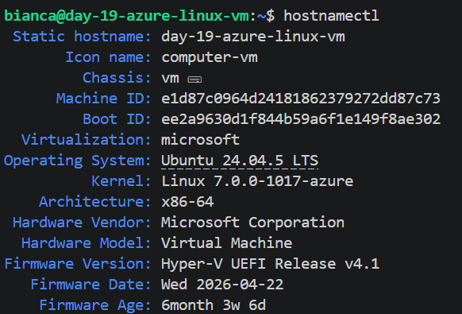

    The VM running on my computer had Oracle s Virtualization, while Azure VM uses microsoft. Kernel, hardware and firmware information also changed.

5. Open the resource group and name every resource created alongside the VM

    All regources > week-5
    
    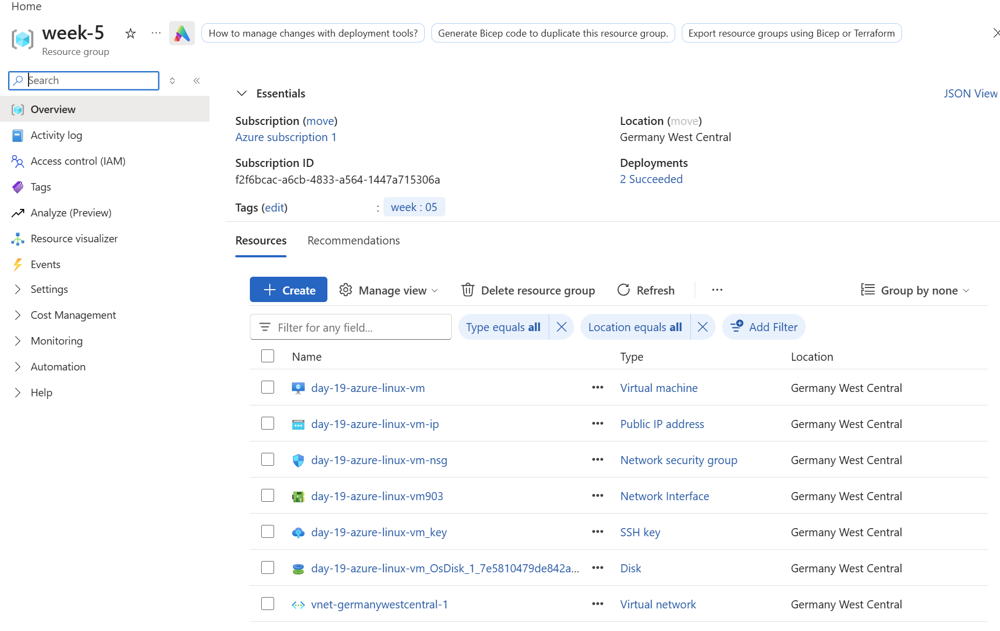

    * Virtual Machine: the compute resource. It runs the OS and the app, and defines the size (CPU and memory). It is the only resource that stops billing for compute when deallocated.
    * Public IP address: the address that makes the VM reachable from the internet, for example over SSH from Windows. It is a separate resource and can be kept when the VM is deallocated.
    * Network security group: a set of allow and deny rules for inbound and outbound traffic, evaluated by priority. It decides what gets through, for example SSH on port 22. It plays the role that ufw plays on the local VM, but it is applied outside the VM.
    * Network Interface: the virtual network card. It connects the VM to the virtual network, holds the private IP address, and is where the public IP and the network security group are attached.
    * SSH key: the public key stored in Azure and installed on the VM for key login. The private key is downloaded once at creation, and Azure does not keep it.
    * Disk: the managed disk that holds the OS (and data, if added). It persists when the VM is deallocated, so it keeps costing a little.
    * Virtual Network: the private network the VM lives in, divided into subnets. The network interface gets its private IP from it. It is the Azure counterpart of the host-only network on the local VM.

6. Set auto-shutdown for the VM

    <my-vm> > Operations > Auto-shutdown

    Enable marked as on

    Scheduled shutdon 09:00:00 AM

    Timezone set to Berlin

    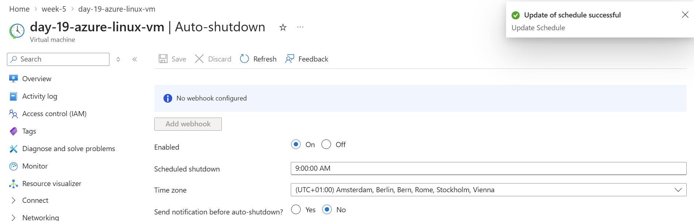
    
7. Stop the VM so that it is deallocated, and confirm its status in the portal

    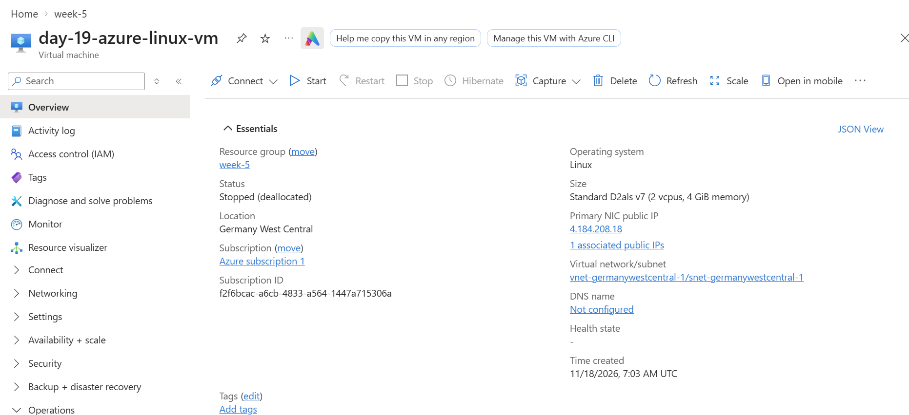

## What worked
1. Azure created all minimum necessary resources that I need to run a VM, instead of me having to create and configure them all manually, like for my local VM. This helps, as part of the complexity is abstracted by Azure as a provider. 

## What did not work
1. While creating VM, the validation failed

    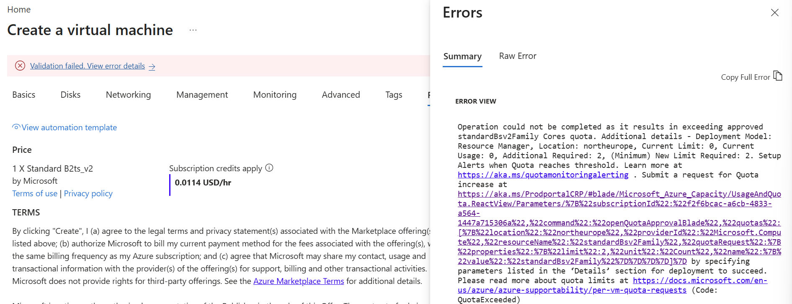

    The machine size I choose initially to create was not available in my quota. 
2. While creating a first VM, I didn't enabled public IP address and was not able to connect to is from my computer, as it is not inside the Virtual network. So I deleted the first created group of resource and did the process again, enabling public IP. 

## How I solved it
1. I checked the quota available and select a region that I had quota. I created a new resource group and a VM in this region (Germany West Central), than the validation passed.
2. I had two options: connect my computer to virtual network using AzureVPN Gateway or create a VM with a public IP address. I choose the second, as it is simpler. It's not the most secure way, and will change on later on phases, once I have more to protect. 

## What I would do differently
1. Check my quota before attempting to create a VM
2. Enable public IP upfront
