# Day 20: Expense app on the Azure VM

**Outcome:** The expense app running as a systemd service on the Azure VM, with its PostgreSQL database.

**Done when:** 
1) The VM is started and I connect over SSH. 
2) PostgreSQL runs on the VM with the app's database and user. 
3) The app runs as a systemd service and answers on its own port from the VM itself (curl). 
4) The VM is deallocated at the end of the session. 
5) The README documents what I did, what worked, what did not, and what differed from the local VM.

## What I did
0. Connect with SHH and handle package management update and upgrade
    `ssh -i <private-key-patj> bianca@<new-public-ip>` 

    `sudo apt update && sudo apt upgrade`

1. Create database
    * Install PostgreSQL
        `apt policy postgresql` - check which version is available for this linux version.

            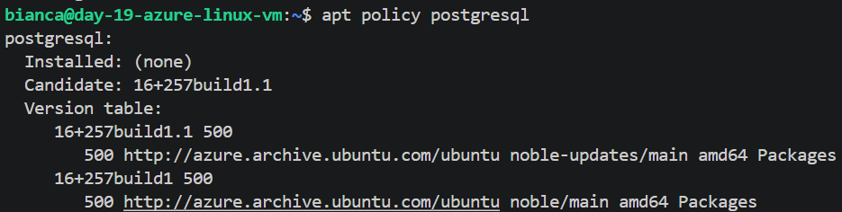

        `sudo apt install postgresql`

        `pg_lsclusters` - version 16 was installed. I'll need to adapt my commands from local VM.

        `systemctl status postgresql@16-main`

        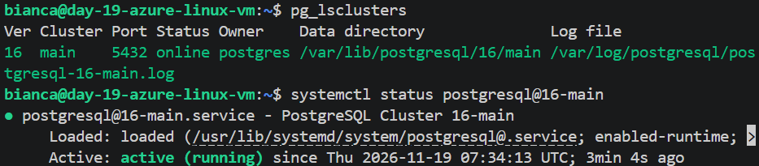

    * Create role
        
        `sudo -u postgres psql`

        `\du`

        `CREATE ROLE expense_app LOGIN NOSUPERUSER NOCREATEDB NOCREATEROLE;`

        `\du`

        `\password expense_app`

    * Create database
        
        `\l`

        `CREATE DATABASE expense_app_db OWNER expense_app;`

        `\l`

    * Connect to DB with it's user
        `psql -h localhost -U expense_app -d expense_app_db`

        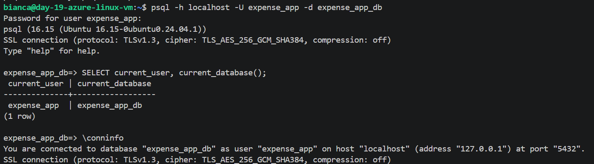

2. Create secret files with API key and database password
    * Create file
        `sudo mkdir -p /etc/expense-api`

        `sudo install -m 600 -o bianca -g bianca /dev/null /etc/expense-api/expense-api.env`

        `nano /etc/expense-api/expense-api.env`

        ```
            DB_PASSWORD_EXPENSE=my-db-password
            EXPENSE_API_KEY=my-api-key
        ```
    * Load env variable

        `nano ~/.bashrc`

        ```
            set -a
            source /etc/expense-api/expense-api.env
            set +a
        ```

        `source ~/.bashrc`

3. Run application amnually
    * Clone application

        `git clone https://github.com/dcastrobianca/basic-expense-app.git`
    * Install Java

        `sudo apt install openjdk-25-jdk-headless`

        `java -version`
    * Install Maven

        `sudo apt install maven`

        `mvn --version`

    * Build jar
        
        `cd basic-expense-app/expense-api/`

        `mvn package`

    * Run application

        `java -jar target/expense-api.jar`

    * Test with baseline requests
        * GET /actuator/health
            
            `curl localhost:8080/actuator/health -i`

        * POST /expenses

            `curl -X POST localhost:8080/expenses -H "X-API-Key: $EXPENSE_API_KEY" -H 'Content-Type: application/json' -d '{"description":"Lunch","amount":12.50,"currency":"USD"}' -i`

        * GET /expenses

            `curl localhost:8080/expenses -H "X-API-Key: $EXPENSE_API_KEY" -i`

        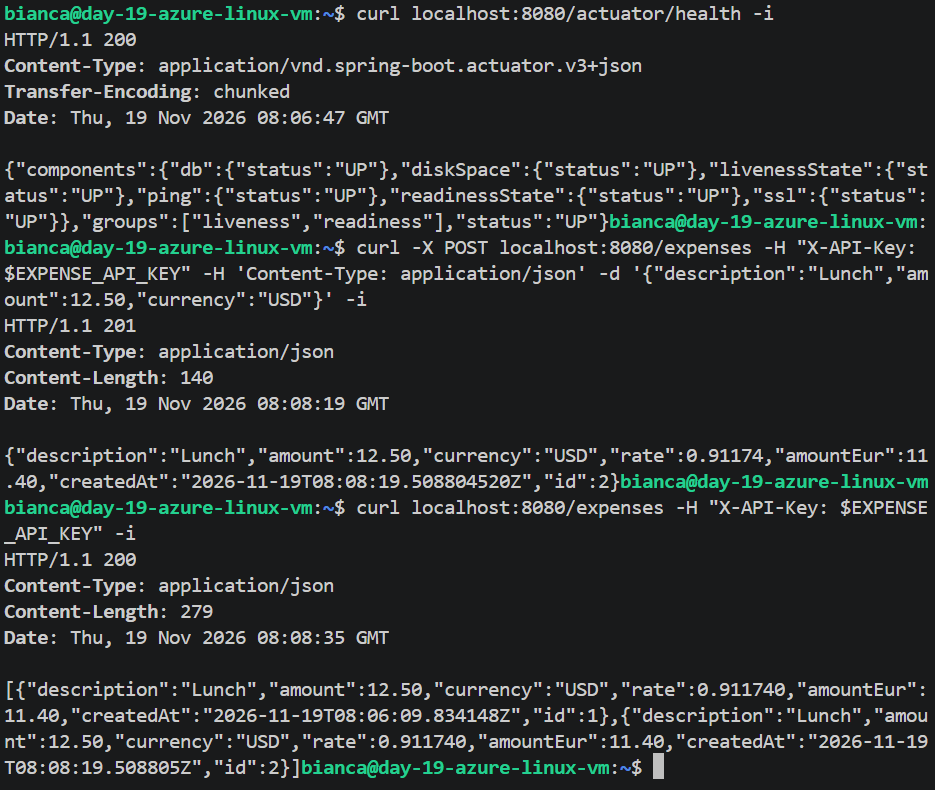

        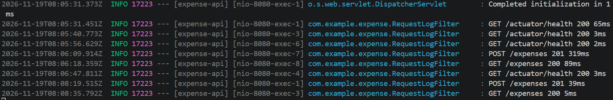

4. Run application as service
    * Jar in proper filapath and set permission
        `sudo mkdir -p /opt/expense-api`
        `sudo mv ~/basic-expense-app/expense-api/target/expense-api.jar /opt/expense-api/`
        `sudo chown root:root /opt/expense-api/expense-api.jar`
        `sudo chmod 644 /opt/expense-api/expense-api.jar`
        `cd /opt/expense-api`
        `ls -la`

        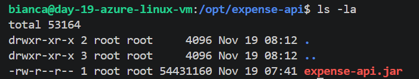

    * Secrets with proper permission
        `sudo chown root:root /etc/expense-api/expense-api.env`
        `sudo chmod 600 /etc/expense-api/expense-api.env`
        `cd /etc/expense-api/`
        `ls -la`

        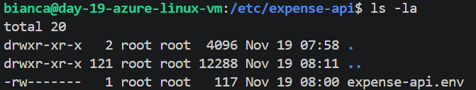

    * Make EXPENSE_API_KEY accessable to run tests

        `nano ~/.bashrc`

        Add to end of file`expense_key() { sudo grep '^EXPENSE_API_KEY=' /etc/expense-api/expense-api.env | cut -d= -f2-; }`.
        Remove " set -a... set +a" as it will fail  because env file became root:root.

    * Create user to run app 

        `sudo useradd --system --no-create-home --shell /usr/sbin/nologin expense-api`

    * Create service definition
        `sudo nano /etc/systemd/system/expense-api.service`

        ```
            [Unit]
            Description=Expense API
            After=network.target postgresql.service

            [Service]
            User=expense-api
            EnvironmentFile=/etc/expense-api/expense-api.env
            ExecStart=/usr/bin/java -jar /opt/expense-api/expense-api.jar
            SuccessExitStatus=143
            Restart=on-failure
            RestartSec=5

            [Install]
            WantedBy=multi-user.target
        ```

        `sudo systemctl daemon-reload`        

        `sudo systemctl enable --now expense-api`

    * Test with baseline requests
        * GET /actuator/health

            `curl localhost:8080/actuator/health -i`
        * GET /expenses
            `curl localhost:8080/expenses -H "X-API-Key: $(expense_key)"`

        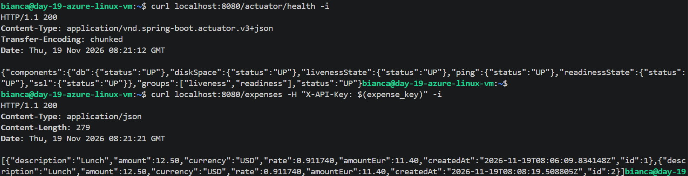

    * Check service logs and status
        `systemctl status expense-api`

        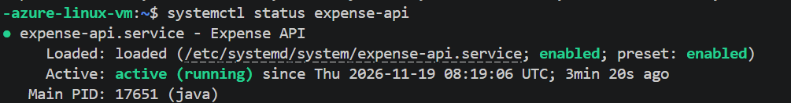

        `journalctl -u expense-api -o cat --no-page -n 10`

        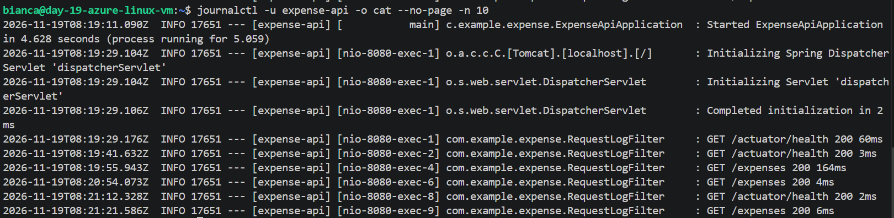

5. Stop VM on azure portal to avoid unecessary expenses

    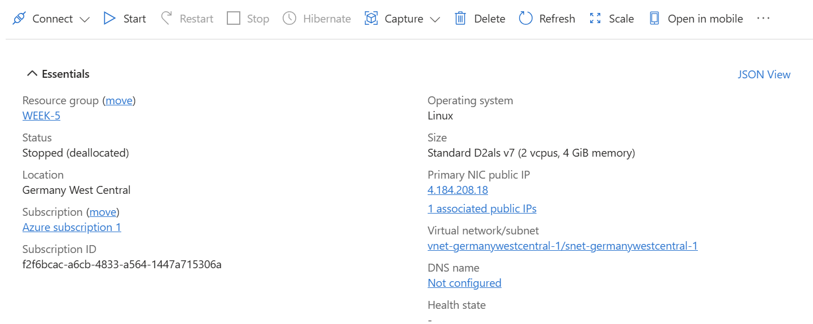

## Difference from Local VM

|Condition|Azure |Local VM|
|-|-|-|
|Ubuntu| 24.04.5| 26.4.1|
|ssh conection| Public IP and network rules from Network Security Group| host-only adapter and ufw rules|
|PostgreSQL|16.15|  18|
|sudo| passwordless sudo for my user| requires password set while creating VM|

## What worked
1. Repeating the same process to deploy the app in azure VM as for local. There were just small diferences mantioned above, but most commands stayed the same as for local machine. 

## What did not work
Nothing to report here.